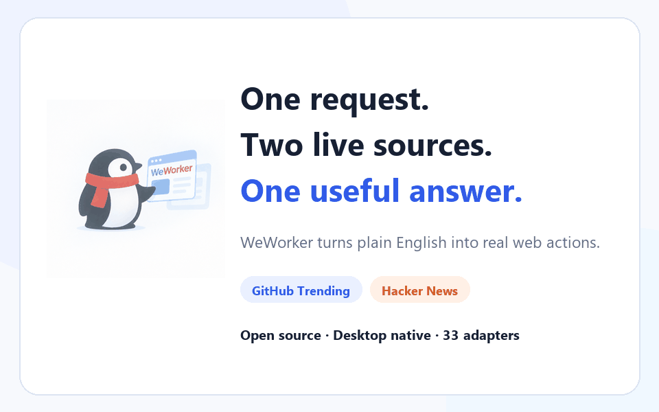

<div align="center">

# WeWorker

[English](README.md) | [中文](README_CN.md)

**The open-source desktop AI agent that takes real actions on websites**

Natural-language tasks → Adapters → real browser actions. Includes 33 website Adapters for Windows and macOS.

**Not advice. Actions.**

[](LICENSE)
[](https://github.com/WeWorker/WeWorker/actions/workflows/validate.yml)
[](https://github.com/WeWorker/WeWorker/releases)
[](https://github.com/WeWorker/WeWorker/stargazers)
[](https://github.com/WeWorker/WeWorker/issues)

[Website](https://www.weworker.cc) · [Download](https://www.weworker.cc/download) · [Quick start](https://www.weworker.cc/docs/quick-start) · [33 Adapters](docs/ADAPTERS.md) · [Discussions](https://github.com/WeWorker/WeWorker/discussions)



</div>

WeWorker turns a natural-language request into real website actions. Its AI agent selects an Adapter and operates through your browser extension or the bundled Toolkit runtime. You stay in control of important steps such as login, submission, purchase, and payment.

## See it in one minute

Ask WeWorker:

```text
Check GitHub Trending and Hacker News, then organize the most interesting AI tools into a concise list.
```

WeWorker selects the relevant Adapters, reads both websites, and returns an organized result instead of merely explaining what you should do. [See the cross-site demo on the website](https://www.weworker.cc/#demo).

Use it for:

- **Cross-site research:** collect, compare, and summarize information from several websites.
- **Repetitive web work:** check mail, search content, fill forms, and run scheduled tasks.
- **Extensible site automation:** describe website tools with Adapters and call them through one `webcli call` interface.

## Highlights

- **Operate websites with natural language:** describe a task in the desktop app and let the agent select the right website tools.
- **33 built-in Adapters:** mail, shopping, social, content, travel, developer tools, and more.
- **Two Adapter runtimes:** Extension Adapters operate through Chrome; Toolkit Adapters run through the bundled runtime. Both use the same `webcli call` entry point.
- **Website exploration agent:** assists with exploring websites and creating, verifying, and maintaining website tools.
- **Scheduled tasks and notifications:** run configured work on a schedule and deliver results through supported notification channels.
- **Local site memory:** keep website-related working context locally.
- **Multiple model providers:** Anthropic, Zhipu, DeepSeek, and compatible custom endpoints.

## Adapter support

WeWorker currently ships with 33 public website Adapters. Examples include:

| Website | Adapter ID | Capabilities |
| --- | --- | --- |
| QQ Mail | `mail.qq.com` | Search mail, read unread messages and details, download attachments and invoices |
| 163 Mail | `mail.163.com` | Search and read mail, download attachments, compose messages |
| JD.com | `jd.com` | Product search, cart, orders, product details, purchase and payment flows |
| Xiaohongshu | `xiaohongshu.com` | Search and read posts and comments, like, save, publish, and manage drafts |
| Bilibili | `bilibili.com` | Search videos, read details and comments, like and save |
| Zhihu | `zhihu.com` | Search, questions, answers, comments, trending topics, likes and saves |
| GitHub | `github.com` | Read Trending repositories |
| Douban | `douban.com` | Search titles, details, reviews, Top 250, albums and status updates |

See the complete [Adapter catalog](docs/ADAPTERS.md) for current coverage and capability boundaries.

## Quick start

### Download the desktop app

Choose your platform on the [download page](https://www.weworker.cc/download). Installers are hosted in [GitHub Releases](https://github.com/WeWorker/WeWorker/releases):

- Windows 10/11 x64: `.exe`
- macOS Intel: x64 `.dmg`
- macOS Apple Silicon: arm64 `.dmg`

Refer to the relevant Release notes for current signing and distribution status.

### Run from source

Requirements:

- Node.js 22.x — other major versions are not supported
- npm
- [uv](https://docs.astral.sh/uv/)
- Chrome or Chromium

```bash
git clone https://github.com/WeWorker/WeWorker.git
cd WeWorker/weworker
npm run install:all
npm run dev
```

The first installation downloads the website exploration agent environment, Electron, and project dependencies. It can take a while even when no new output appears.

### Load the browser extension in development

1. Open `chrome://extensions/` in Chrome.
2. Enable Developer mode.
3. Select **Load unpacked**.
4. Choose the repository's `extension/` directory.

## WebCLI

List and call installed Adapters from the command line:

```bash
# List available Adapters
webcli list

# Call an Adapter tool
webcli call <adapter-id>.<tool-id> --key=value
```

The core execution path is:

```text
User task → AI agent → WebCLI → Extension/Toolkit Adapter → website
```

See the [WebCLI documentation](webcli/README.md) for installation and command details.

## Safety and data boundaries

- Never put API keys, tokens, cookies, passwords, private accounts, or personal data in the repository, an Issue, logs, or screenshots.
- Task content is sent to the model provider selected by the user; review that provider's privacy policy.
- Website actions use the account already signed in to the browser and have the same effect as actions performed by that user.
- Bridge and local services should not be exposed to public networks.
- Metrics upload is disabled by default and only runs after explicit configuration.
- Review extension permissions and enabled Adapters, and only run code you trust.
- Report security vulnerabilities privately through [SECURITY.md](SECURITY.md), not a public Issue.

## Project structure

```text
WeWorker/
├── weworker/              Electron desktop app, Renderer, Backend, and build scripts
├── adapters/              Built-in host-managed Adapter packages
├── extension/             Chrome extension and Extension Adapter runtime
├── webcli/                Unified Adapter CLI and Bridge
├── officialWeb/           Product website and documentation
└── docs/                  Architecture, contribution, release, and maintenance docs
```

## Development and build

The primary development entry point is `weworker/`:

```bash
cd weworker
npm run install:all
npm run dev
```

Production packages must be built on their target operating system:

```bash
# Windows x64
cd weworker
npm run build:win

# Native macOS architecture
cd weworker
npm run build:mac
```

More documentation:

- [Desktop development and build](weworker/README.md)
- [Local build guide](LOCAL_BUILD_AI_GUIDE.md)
- [Extension and Adapter development](extension/README.md)
- [WebCLI](webcli/README.md)
- [Website development](officialWeb/README.md)

## Contributing

Bug fixes, documentation, tests, new capabilities, and public website Adapters are welcome. Read the [contribution guide](CONTRIBUTING.md), [code of conduct](CODE_OF_CONDUCT.md), [support guide](SUPPORT.md), and [Git workflow](docs/GIT_WORKFLOW.md) before opening a PR.

### Adapter contribution challenge

Is a website you use missing from the catalog? Submit a PR for a public website Adapter. Once merged, we will showcase the contribution and thank its author in the community and release updates.

[Browse the Adapter catalog](docs/ADAPTERS.md) · [Read the contribution guide](CONTRIBUTING.md) · [Propose an Adapter](https://github.com/WeWorker/WeWorker/issues/new/choose)

## Version

The current public version is `1.0.1`. See [CHANGELOG.md](CHANGELOG.md) for public release history and [the release guide](docs/RELEASE.md) for the maintainer workflow.

---

If WeWorker saves you time, a GitHub Star is the best way to support the project ⭐

## License

WeWorker is released under the [Apache License 2.0](LICENSE). See [Third-Party Notices](THIRD_PARTY_NOTICES.md) for dependency notices. Third-party websites, trademarks, and services belong to their respective owners; using an Adapter remains subject to each website's terms and applicable rules.
