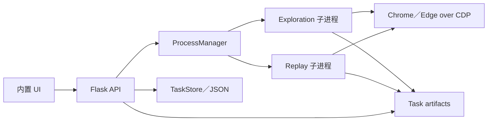
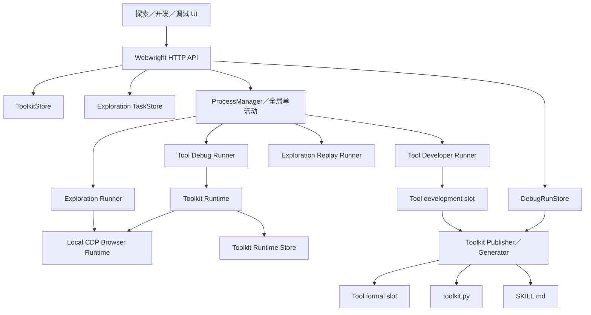
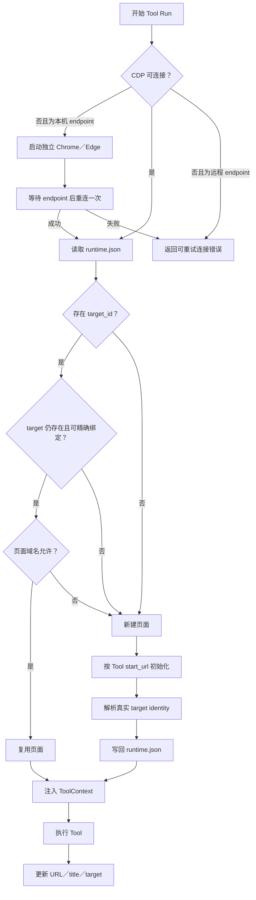
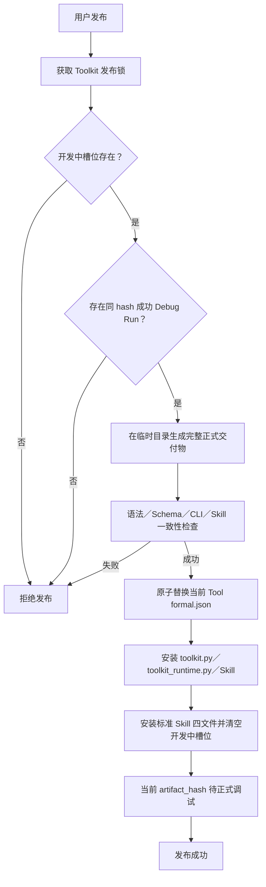

# Webwright Toolkit 技术设计

> 当前执行合同：Publisher 生成五文件 Toolkit Adapter Skill，WebCLI 根据 `adapter_type=toolkit` 发现并通过 embedded runtime 的 `--internal-script` 执行。用户入口为 `webcli call`，不再提供 `webcli-py`。完整设计见 [`../../../docs/webcli_toolkit_adapter_design.md`](../../../docs/webcli_toolkit_adapter_design.md)。本文后续历史描述中的旧命令与四文件合同不再构成现行规范。

## 文档状态

- 当前版本：`2.9`
- 更新时间：2026-08-06
- 关联产品设计：[`toolkit_product_design.md`](toolkit_product_design.md)
- 关联 Roadmap：[`toolkit_roadmap.md`](toolkit_roadmap.md)
- 状态：阶段一至阶段七、五文件 Toolkit Adapter、统一 `webcli call` 入口、Skill 域名描述、embedded 分发运行时与 WeWorker 磁盘直装已实现
- 适用范围：Python harness 的 `local_browser + local_cdp` 模式

## 一、结论

Toolkit 产品升级在现有工程上技术可行，整体可行性高，属于中大型架构升级。

现有工程可以直接复用：

- 模型 backend 和 `DefaultAgent` 基础循环。
- `local_browser + local_cdp` 探索执行链。
- Follow-up、暂停、人工接管和原始步骤 replay。
- 浏览器启动、标签页查询、target 激活和真实 CDP identity 映射。
- 子进程执行、进程取消、状态 watcher 和 SSE 推送。
- steps、trajectory、截图和错误产物。
- 本地 JSON Store 和单文件原子写入方式。

需要新增的核心能力：

- Toolkit／Tool 领域模型和持久化。
- Tool Developer Agent 和专用开发环境。
- 正式版本／开发中版本双槽位。
- Toolkit Runtime 和 Runtime Store。
- 参数化自包含 CLI 和 Skill 生成器。
- Debug Run 执行链。
- Tool 发布流程。
- 以 Toolkit／Tool 为中心的探索、开发、调试三工作区。

不存在需要先验证的技术阻塞。严格 `target_id → Playwright Page` 映射已经完成并通过真实 CDP 验证；Toolkit Runtime 只需要复用该能力并增加运行时状态管理。

## 二、设计目标与边界

### 2.1 设计目标

1. 所有探索、开发和调试活动都归属于明确的 Tool。
2. 一个 Toolkit 组织同一允许域名范围内的多个 Tool。
3. 一个 Tool 可以有多次 Exploration，但当前开发周期最多使用一次 Exploration。
4. Tool 只有正式版本和开发中版本两个槽位。
5. Tool 接口只暴露业务参数，不暴露 `target_id` 和 `cdp_url`。
6. Toolkit Runtime 自动创建、复用并维护浏览器页面。
7. 正式 CLI 可以脱离 Exploration、server 和已安装的 Webwright 包运行，只依赖同目录 `toolkit_runtime.py` 与固定版本 Playwright。
8. 当前开发中代码必须有相同代码哈希的成功 Debug Run 才能发布。
9. Toolkit 的正式 CLI 运行规格和 Skill 必须由同一正式事实源确定性生成并保持一致。
10. 同一 Toolkit 中的多个 Tool 可以顺序操作同一个页面。
11. 正式 Runtime 在本机 CDP endpoint 不可用时自动启动浏览器，在保存的 target 失效时重建页面；恢复不得重跑已开始执行的业务 Tool。

### 2.2 MVP 边界

MVP 不做：

- 多 Exploration 合并开发。
- 代码修改历史和任意版本回滚。
- 多个正式版本并存。
- Toolkit Revision。
- 旧 Task 数据兼容或迁移。
- 复杂 Agent 完成门禁。
- 高于现有探索代码执行级别的额外安全沙箱。
- 多活动并发和多浏览器并行。
- 可视化 DAG、条件分支和通用工作流引擎。
- Browserbase、`local_launch` 和 `local_persistent`。
- 跨 Toolkit 的页面状态共享。
- 零依赖单文件交付。
- 自动公开发布、生产部署或工具市场。

## 三、现有架构基线

当前 server 采用 Flask、文件型 Store 和独立子进程：



当前架构的重要特征：

- HTTP 请求不直接执行模型或浏览器操作。
- 任意时刻只允许一个 task 或 replay 子进程活动。
- `LocalBrowserEnvironment` 在子进程中连接真实浏览器。
- Exploration 产物以任务目录为边界保存。
- UI、API、状态机和文件产物读取已经形成完整闭环。
- 当前实现原先默认从源码仓库启动，将 `sys.executable` 当作通用 Python 解释器、
  将相对 `outputs/server/` 当作数据根目录，并按源码文件路径读取 YAML、Web UI 和
  canonical Runtime；完整分发必须由统一路径、RuntimeLauncher 和包内资源合同替换
  这些假设。

升级不改变这些基础原则，而是在其上增加 Toolkit 领域层、开发执行链和 Tool Runtime。

## 四、目标架构



### 4.1 分层

#### 产品领域层

管理：

- Toolkit。
- Tool。
- Exploration 归属。
- 正式／开发中双槽位。
- Debug Run。
- 发布规则。

#### Agent 执行层

包含两条不同执行链：

- Exploration Agent：操作浏览器并收集证据。
- Tool Developer Agent：读取一次 Exploration，开发当前 Tool 的开发中版本。

两者复用模型 backend 和基础 Agent 循环，但使用不同 prompt、环境和完成条件。

#### Tool Runtime 层

负责：

- Toolkit Runtime Store。
- local CDP 连接。
- 页面复用和失效重建。
- 允许域名校验。
- ToolContext 注入。
- Tool 调用、超时和结构化输出。

#### 生成与发布层

负责：

- 校验开发中槽位。
- 校验成功 Debug Run。
- 生成 Toolkit 正式 CLI。
- 生成正式 Skill。
- 替换当前 Tool 的正式槽位。

#### 展示与控制层

由 Flask API、SSE 和三工作区 UI 组成，不直接执行模型和 Tool。

## 五、领域模型

### 5.1 Toolkit

建议字段：

```json
{
  "toolkit_id": "blog_admin",
  "name": "blog_admin",
  "description": "管理博客站点",
  "allowed_domains": [
    "blog.example.com",
    "auth.example.com"
  ],
  "created_at": "",
  "updated_at": ""
}
```

规则：

- `toolkit_id` 在本地唯一。
- `name` 与 `toolkit_id` 取值相同：创建时用户只填一个名称，同时写入两个字段，不单独提供标识输入。
- `allowed_domains` 必须显式配置。
- 不把 `example.com` 自动扩展为任意子域名。
- `about:blank` 仅允许作为 Runtime 新建页面的临时状态。
- Toolkit 不设置生命周期状态。

### 5.2 Tool

建议字段：

```json
{
  "tool_id": "search_blog",
  "toolkit_id": "blog_admin",
  "name": "search_blog",
  "goal": "根据关键词搜索已有博客并返回匹配结果",
  "start_url": "https://blog.example.com/admin/posts",
  "expected_effect": "页面显示搜索结果并返回结构化列表",
  "created_at": "",
  "updated_at": ""
}
```

`name` 与 `tool_id` 取值相同：创建时用户只填一个名称，同时写入两个字段。

Tool 不保存复杂状态。界面只根据以下事实展示当前情况：

- 是否存在正式槽位。
- 是否存在开发中槽位。
- 是否有正在运行的 Exploration、开发任务或 Debug Run。

### 5.3 Exploration

现有 Task 在产品层重命名为 Exploration，底层产物和执行链继续复用。

Task metadata 新增：

```json
{
  "activity_type": "exploration",
  "toolkit_id": "blog_admin",
  "tool_id": "search_blog"
}
```

创建 Exploration 时必须校验 Toolkit 和 Tool 存在且归属一致。

### 5.4 Tool Slot

正式槽位和开发中槽位使用同一种数据结构：

```json
{
  "tool_id": "search_blog",
  "code": "async def search_blog(ctx, *, keyword): ...",
  "code_hash": "sha256:...",
  "description": "根据关键词搜索博客",
  "parameters_schema": {},
  "result_schema": {},
  "risk_notice": "",
  "source_exploration_id": "",
  "based_on_formal_hash": "",
  "debug_run_evidence_id": "",
  "updated_at": ""
}
```

槽位规则：

- 正式槽位和开发中槽位各最多一个。
- 开发修改只覆盖开发中槽位。
- 不保存旧槽位内容。
- 首次开发必须引用一次成功 Exploration。
- 后续开发默认复制正式槽位；如果重新探索，最多补充一次 Exploration。
- 开发中槽位存在期间不得更换 `source_exploration_id`。
- `debug_run_evidence_id` 记录用户为本轮开发明确选择的 Debug Run，可随时更换或清除，仅开发中槽位使用。

### 5.5 Debug Run

建议字段：

```json
{
  "debug_run_id": "debug_...",
  "tool_id": "search_blog",
  "channel": "development",
  "code_hash": "sha256:...",
  "artifact_hash": "",
  "parameters": {},
  "status": "succeeded",
  "result": {},
  "error": "",
  "before_page": {
    "url": "",
    "title": ""
  },
  "after_page": {
    "url": "",
    "title": ""
  },
  "created_at": ""
}
```

不单独记录 `toolkit_id`：Toolkit 可通过 `tool_id` 反查所属 Tool 得到，不在 Debug Run 上重复保存。`created_at` 即代表本次运行的记录时间，不单独维护 `updated_at`。

Debug Run 不向 AI 或 Tool 暴露原始 `target_id`，也不保存完整代码快照。`code_hash` 判断运行是否对应当前 Tool 代码；`artifact_hash` 仅在 `formal` 渠道填写，用于证明运行对象是当时已发布的整套正式产物，`development` 渠道固定为空。

## 六、文件存储设计

建议目录：

```text
~/.weworker/webwright/
├── tasks/
│   └── <exploration_id>/
│       ├── .server/
│       ├── trajectory.json
│       ├── steps/
│       ├── screenshots/
│       └── script.py
├── toolkits/
    └── <toolkit_id>/
        ├── runtime.json
        ├── <skill-name>/
        │   ├── SKILL.md
        │   └── scripts/
        │       ├── toolkit.py
        │       ├── toolkit_runtime.py
        │       └── requirements.txt
        ├── tools/
        │   └── <tool_id>/
        │       ├── tool.json
        │       └── formal.json
        ├── development/
        │   └── <tool_id>/
        │       ├── current.json
        │       ├── workspace/
        │       └── process.log
        ├── debug_runs/
        │   └── <debug_run_id>/
        │       ├── debug_run.json
        │       ├── process.log
        │       └── screenshots/
        └── .server/
            ├── publish.json
│           └── build.json
├── browser/profile/
├── toolkit-state/
├── models.json
├── .env
└── logs/
```

设计原则：

- Exploration 继续使用现有 `tasks/` 结构，减少对探索执行链的改动。
- Toolkit 领域数据放在独立根目录。
- 正式和开发中槽位各用一个 JSON 作为事实源，代码保存在 JSON 的 `code` 字段中。
- `<skill-name>/` 是工程内唯一、确定性的正式 Skill 交付物，不创建候选产物或历史 Build 目录。
- `SKILL.md` 位于 Skill 根目录，`toolkit.py`、canonical `toolkit_runtime.py` 和 `requirements.txt` 位于 `scripts/`。
- `scripts/toolkit.py` 内嵌正式 Tool、Toolkit ID、允许域名、起始 URL 和参数／返回值 Schema，从同目录导入 Published Toolkit Runner；不得读取 `formal.json`、依赖 ToolkitStore 或导入已安装的 Webwright 包。
- Toolkit 目录根部 `runtime.json` 只供工程内 Debug 使用，属于 WebwrightHome 的
  `toolkits/<toolkit_id>/`；外部分发 Runtime 使用 `~/.weworker/webwright/toolkit-state/`，或由
  `WEBWRIGHT_STATE_DIR` 覆盖，两者不共享状态文件，Skill 目录保持无状态。
- 所有 Store 写入继续使用临时文件加 `os.replace()`。
- 不创建历史版本目录。

## 七、Toolkit Runtime

Toolkit Runtime 拆成共享执行内核和两个适配层：

```text
共享执行内核
├── 参数／返回值 Schema 校验
├── 浏览器连接、页面选择和域名约束
├── ToolContext、截图和结构化输出
└── Runtime 状态读写接口

适配层
├── Store Tool Runner：读取开发中槽位，仅供 development Debug
└── Published Toolkit Runner：接收 toolkit.py 显式传入的运行规格，状态路径由内部覆盖或用户状态目录解析
```

Canonical Published Toolkit Runner 位于 `webwright.tool_runtime.toolkit_runtime`。该文件必须自包含，不得导入任何 `webwright.*` 模块；Publisher 将其字节原样复制为正式 Skill 的 `scripts/toolkit_runtime.py`。正式 CLI 从同目录导入该副本，因此不能依赖 Webwright server、ToolkitStore、工程内部目录或已安装的 Webwright 包。

### 7.1 Runtime Store

每个 Toolkit 维护一个运行时状态：

```json
{
  "target_id": "",
  "last_url": "",
  "last_title": "",
  "updated_at": ""
}
```

该文件属于运行时内部状态：

- 不属于 Tool 参数。
- 不写入正式 CLI 和 Skill。
- 不通过正式 CLI 输出。
- 不提供给调用 Tool 的 AI。
- 不提供给 Tool Developer Agent。

### 7.2 页面选择算法



具体规则：

1. 先尝试连接 CDP；本机 endpoint 连接失败时使用独立用户目录自动启动 Chrome／Edge，等待可用后只重连一次。
2. 远程 endpoint 不可用时不得启动本机浏览器，直接返回可重试连接错误。
3. 读取 Toolkit 的 Runtime Store。
4. 如果保存了 `target_id`，先通过 CDP target 列表确认仍然存在。
5. 使用已经实现的 `Target.getTargetInfo` identity 映射精确绑定 Playwright Page。
6. target 缺失、页面已关闭、绑定失败或当前域名不允许时，新建页面并使用 Tool 的 `start_url` 初始化。
7. 获取新页面的真实 target identity 后原子覆盖 Runtime Store 中的旧状态。
8. 页面在绑定与业务函数启动之间关闭时，允许再重建一次页面；不得在业务函数已经开始后自动重跑 Tool。
9. Tool 执行完成或失败后，只要页面仍存在，就更新实际 target、URL 和标题。
10. Runtime Store 写入失败不应把业务执行误报为成功。

严格绑定能力本身不做降级；“复用失败后新建”由 Toolkit Runtime 在绑定之前和失败之后负责协调。

### 7.3 ToolContext

Tool 不接收 `target_id` 或 `cdp_url`，Runtime 注入上下文：

```python
@dataclass
class ToolContext:
    page: Page
    browser_context: BrowserContext
    browser: Browser
```

Tool 函数形式：

```python
async def search_blog(
    ctx: ToolContext,
    *,
    keyword: str,
    exact_match: bool = False,
) -> dict[str, Any]:
    ...
```

CLI 只暴露业务参数：

```bash
webcli call blog-admin.search-blog --keyword=Webwright --exact-match=true
```

### 7.4 输出协议

stdout 只输出一份 JSON：

```json
{
  "ok": true,
  "tool": "search_blog",
  "data": {},
  "page": {
    "url": "",
    "title": ""
  }
}
```

错误输出：

```json
{
  "ok": false,
  "tool": "search_blog",
  "error": {
    "code": "element_not_found",
    "message": "未找到搜索框",
    "retryable": false,
    "needs_user": false
  },
  "page": {
    "url": "",
    "title": ""
  }
}
```

规则：

- 成功退出码为 `0`。
- 业务或运行失败退出码为非零。
- 调试日志写入 stderr 和 Debug Run 日志，不混入 stdout JSON。
- 输出不包含 `target_id`。

### 7.5 运行互斥

MVP 保持全局单活动进程：

```text
exploration
exploration_replay
development
debug
```

任意时刻只允许其中一个处于运行状态。这样与现有 ProcessManager 行为一致，也避免多个活动同时修改浏览器页面或 Toolkit 文件。

## 八、Tool Developer Agent

### 8.1 为什么不能直接复用 Exploration Agent

当前 `local_browser` prompt 明确规定没有 workspace、不写文件、每轮只执行页面代码。Tool 开发需要读写开发中槽位、运行静态检查并生成多个一致产物，因此必须使用独立开发执行链。

### 8.2 可复用部分

- 模型 provider 和模型配置。
- `DefaultAgent` 的 query／execute／resume 基础循环。
- trajectory 和调试日志机制。
- 子进程入口和 watcher 模式。

### 8.3 新增开发环境

新增专用 `ToolDevelopmentEnvironment`，而不是扩展现有通用 `local_workspace` 模式。

职责：

- 建立当前 Tool 的临时开发工作区。
- 投影唯一来源 Exploration 的必要证据。
- 写入正式槽位只读副本或当前开发中槽位。
- 提供当前 Tool 的代码、Schema 和契约。
- 提供用户明确选择的 Debug Run。
- 允许执行本地代码检查命令。
- 将最终结果整理为开发中槽位 JSON。

开发 Agent 工作区不得包含：

- 其他 Exploration 的证据。
- 未选择的 Debug Run。
- Toolkit `runtime.json`。
- 模型 API Key。
- 其他 Tool 的可写源码。
- Toolkit 正式交付文件的写权限。

这属于上下文和职责隔离，不提升到额外 OS 安全沙箱。生成代码的执行安全级别与当前探索阶段保持一致。

### 8.4 开发输入

首次开发：

```text
Tool metadata
+ 唯一成功 Exploration 的证据投影
+ Toolkit 允许域名和 Runtime 契约
```

后续开发：

```text
正式槽位副本或当前开发中槽位
+ 可选的一次 Exploration
+ 用户明确选择的一次 Debug Run
+ 用户开发指令
```

从探索重新开发使用显式 `exploration_only=true` 输入模式：

```text
Toolkit／Tool 产品定义与允许域名
+ 唯一成功 Exploration 的完整证据投影
+ 本次开发指令
```

`build_development_input()` 在该模式下必须直接设置 `base_slot = None`、`debug_run_evidence = None`，并只读取明确选择的 `source_exploration`。不得依赖调用方清空开发中槽位后再通过 `development or formal` 推导输入，因为正式槽位仍然存在。

`ProcessManager.start_development()` 同样接收并在 Development Run 与运行 spec 中持久化 `exploration_only`。该路径在全局锁内确认无冲突活动，清空开发中槽位，再构造输入、创建并启动 Development Run；运行固定 `based_on_formal_hash = ""`、`debug_run_evidence_id = ""`。Developer 子进程失败时不恢复被清空的开发中版本。

证据投影保留：

- steps 代码和执行结果。
- 页面 URL、标题和 ARIA 证据。
- 失败尝试和异常。
- 成功路径。
- 截图路径。

证据投影过滤：

- 原始 `target_id`。
- 无关模型上下文。
- 未选择 Exploration 的任何数据。
- 密钥和运行环境变量。

### 8.5 开发输出

开发 Agent 必须产出：

- 一个 Tool 函数。
- 参数 JSON Schema。
- 返回值 JSON Schema。
- 描述。
- `risk_notice`。
- Tool 起始 URL。
- 稳定错误码约定。

写入前进行：

- Python 语法检查。
- Tool 函数签名检查。
- 参数和返回值 Schema 校验。
- 禁止暴露 `target_id` 和 `cdp_url` 的接口检查。
- 允许域名检查。
- 确定性代码哈希计算。

MVP 不增加复杂完成门禁。通过上述结构和静态检查后，即可更新开发中槽位；实际可用性由 Debug Run 验证。

## 九、Debug Run

### 9.1 执行方式

Debug Run 使用独立子进程：

```text
development：Debug spec → Tool Debug Runner → Store Tool Runner → development slot
formal：Debug spec → Tool Debug Runner → 已发布 toolkit.py → Published Toolkit Runner
两条路径最终都进入 local CDP page 并生成 Debug artifacts
```

`ProcessManager` 通过 `RuntimeLauncher.worker_command("tool-debug", spec_path)` 启动外层
Debug Worker。formal 渠道再通过 `RuntimeLauncher.script_command()` 执行正式
`scripts/toolkit.py`；源码模式使用 Python，冻结模式使用 `--internal-script`，两者都保留
真实 CLI 的 stdin、stdout、退出码、超时和进程树取消语义。

Debug spec 包含：

- Toolkit ID。
- Tool ID。
- `formal` 或 `development`。
- 当前代码哈希。
- `formal` 渠道启动时读取并固定当前 `artifact_hash`；`development` 渠道为空。
- 业务参数。
- 超时配置。

不包含由用户或 AI 提供的 `target_id`。Toolkit Runtime 自行读取 Runtime Store。

`formal` 渠道必须执行 Toolkit 根目录的 `toolkit.py`，不得为了复用旧实现而直接调用 `ToolRunner(channel="formal")`。CLI 通过内部环境变量接收 CDP 地址和截图路径，这些运行参数不进入业务参数 Schema。正式子进程必须纳入现有超时、取消和进程组清理，避免外层 Debug Run 结束后残留 CLI 子进程。

### 9.2 状态

```text
queued
running
succeeded
failed
cancelled
```

### 9.3 发布资格

开发中版本可发布的必要条件：

```text
存在 succeeded Debug Run
且 Debug Run.code_hash == development.code_hash
```

开发中代码发生任何修改后：

- 产生新的代码哈希。
- 旧成功 Debug Run 仍可查看。
- 旧成功记录不再满足发布条件。
- 必须重新执行并获得成功 Debug Run。

不要求 Agent 自动判断“效果令人满意”。Debug Run 的成功状态由运行结果和 Tool 成功判定产生，最终是否发布由用户决定。

### 9.4 正式产物验证与导出资格

单个正式 Tool 对当前产物验证通过的必要条件：

```text
存在 succeeded formal Debug Run
且 Debug Run.code_hash == formal.code_hash
且 Debug Run.artifact_hash == build.artifact_hash
```

Toolkit 只有在所有正式 Tool 都满足上述条件时才可导出。资格由正式槽位、`build.json` 和 Debug Run 动态计算，不持久化独立布尔字段。发布任意 Tool 后 `artifact_hash` 改变，旧正式 Debug Run 自动失效但仍保留查看。

## 十、发布与正式交付物

### 10.1 事实源与生成物

事实源：

- Toolkit metadata。
- 各 Tool 的 `tool.json`。
- 各 Tool 的 `formal.json`。

确定性生成物是唯一正式 Skill 目录：根目录 `SKILL.md`，以及 `scripts/toolkit.py`、`scripts/toolkit_runtime.py`、`scripts/requirements.txt`。

正式 CLI 运行规格和 Skill 必须从 Toolkit metadata 与 Tool 正式槽位确定性生成，不让 AI 单独维护另一份描述。

Publisher 通过 `BundledResources.canonical_toolkit_runtime()` 读取构建时从唯一源码额外
收集的只读资源，不依赖冻结模块存在可读 `__file__`。候选产物的真实 CLI `--help`
校验通过 `RuntimeLauncher.script_command()` 执行，不能降级为 `compile()`。

`artifact_hash` 只覆盖 formal Debug 实际执行的 `scripts/toolkit.py` 和 `scripts/toolkit_runtime.py`。运行所需的 Toolkit ID、允许域名、起始 URL 和参数／返回值 Schema 均内嵌于 `toolkit.py`，因此受同一哈希保护。`SKILL.md` 与 `scripts/requirements.txt` 不参与该哈希，只保存内部 checksum 供导出完整性校验。`formal.json` 继续作为发布恢复、继续开发和一致性重建的内部事实源，但正式运行与正式 Debug 不得读取它。

### 10.2 发布流程



### 10.3 一致性与恢复

多文件无法依赖一次 `os.replace()` 完成整体原子切换，因此使用以下规则：

1. `formal.json` 是当前 Tool 正式实现的唯一事实源。
2. 发布前先在临时目录生成全部正式交付物并完成验证。
3. 发布过程写 `.server/publish.json`，记录目标 Tool、代码哈希和阶段。
4. 原子替换 `formal.json` 后，再逐个原子替换生成物。
5. `build.json` 保存所有正式槽位哈希和正式交付物 build hash。
6. server 启动或正式 Tool 运行前发现 build hash 不一致时，阻止运行并从正式事实源重新生成。
7. 生成成功后清除 publish journal 和开发中槽位。
8. 发布成功不创建候选物，也不表示已经导出；新产物通过新 `artifact_hash` 自然失效旧正式验证。

临时发布文件和 journal 只用于事务恢复，不构成产品版本历史。

### 10.4 CLI 与 Skill

正式 CLI：

- `scripts/toolkit.py` 从同目录 `toolkit_runtime.py` 导入 Published Toolkit Runner，不依赖源码安装的 Webwright 包。由 WeWorker 内置 WebCLI Toolkit Runner 调用 embedded runtime，后者提供固定 Python 与 Playwright；`requirements.txt` 只保留依赖声明，不要求用户安装。
- 不依赖 Exploration、steps、trajectory、ToolkitStore、`formal.json` 或 server。
- 所有 Tool 组织在同一个 `toolkit.py` 中。
- 直接调用文件中嵌入的正式 Tool；Toolkit ID、允许域名、各 Tool 的 `start_url` 和参数／返回值 Schema 同样内嵌于 `toolkit.py`，并显式传给 Published Toolkit Runner。
- 普通 CLI 使用业务参数；formal Debug 通过受控 stdin 向同一正式 CLI 传入原始参数 JSON，由内嵌 Schema 和 Published Toolkit Runner 完成校验。

正式 Skill：

- 只描述正式 Tool。
- frontmatter `description` 由 Toolkit 描述和 `allowed_domains` 组成，使用「当需要操作以下域名的网页时可使用：<allowed_domains>」列出域名，不列举 Tool 名称。
- 只描述业务参数。
- 不包含 `target_id`。
- 描述返回值、错误和风险提示。
- 描述多个 Tool 的组合方式。
- 对保存、发布、提交、删除等副作用给出风险提示。

MVP 不增加额外运行确认或权限门禁，风险级别与现有探索代码执行保持一致。

### 10.5 轻量导出

导出服务只允许复制以下白名单文件：

```text
<skill-name>/
├── SKILL.md
└── scripts/
    ├── toolkit.py
    ├── toolkit_runtime.py
    └── requirements.txt
```

导出前只读校验正式产物哈希、全部正式 Tool 验证资格和两个非哈希分发文件的 checksum，然后逐字节打包工程内正式 Skill 目录。`toolkit_runtime.py` 必须与 Webwright canonical Runtime 字节一致；包内不包含 `runtime.json`；`requirements.txt` 只固定 Playwright 版本。导出不调用模型、不读取 Development Run 证据、不重新渲染或修复正式文件，也不保存导出历史。

本轮不发布独立 Runtime wheel；自包含 Runtime 作为正式文件随每个 Toolkit 分发，不复制或安装包含 Server 和模型后端的完整 Webwright 包。

### 10.6 WeWorker 磁盘直装

磁盘直装是 embedded host 的可选能力，不属于 Toolkit Runtime。Server 启动时只有
收到绝对 `WEWORKER_USER_FILES_DIR` 才公开 capability 并注册安装路由；否则
capability 为 false。

```text
Web UI 同源 POST
→ Webwright 条件安装路由
→ 复核 export-status
→ 从当前正式 Skill 目录复制四文件白名单
→ <user_directory>/.claude/skills/<skill-name>/ 原子覆盖
```

Webwright 前端不能提交安装路径。路由重新计算 `export_status()` 并拒绝
`export_eligible=false`，只读取 Publisher 当前正式 Skill 的四个固定文件。
目标同名目录不判断来源、不维护索引并整体覆盖；使用目标父目录内 staging、旧目录
临时改名和失败回滚，成功后删除临时备份。安装失败不得影响 Webwright 其他 API。

按钮位于全局 Toolkit 工具栏并与「导出 Toolkit」并列，默认 `hidden`；前端读取
公开 capability 后才显示，并按当前 export status 控制 disabled。未配置用户目录时，
DOM 即使被手工解除隐藏，也因服务端没有路由而无法安装。

## 十一、多 Tool 组合

组合由调用正式 Skill 的 AI 决定，Webwright 不建设工作流引擎。

例如：

```text
search_blog(keyword)
→ open_blog(post_id)
→ edit_blog(content)
→ save_blog()
```

技术保证：

- 每次 CLI 调用读取同一 Toolkit 的 Runtime Store。
- Runtime 自动复用同一个浏览器页面。
- 每个 Tool 输出统一 JSON。
- 前一步 `data` 可以作为后一步业务参数。
- 调用 AI 根据前一步结果与当前页面状态判断是否继续组合。
- 某一步失败后由调用 AI 决定是否重试或停止。

调试工作区的固定顺序组合只是一组按顺序执行的 Debug Run，不引入新的 Workflow 领域对象。

## 十二、API 设计

### 12.1 Toolkit 与 Tool

```text
GET    /api/toolkits
POST   /api/toolkits
GET    /api/toolkits/{toolkit_id}
PUT    /api/toolkits/{toolkit_id}
DELETE /api/toolkits/{toolkit_id}

GET    /api/toolkits/{toolkit_id}/tools
POST   /api/toolkits/{toolkit_id}/tools
GET    /api/toolkits/{toolkit_id}/tools/{tool_id}
PUT    /api/toolkits/{toolkit_id}/tools/{tool_id}
DELETE /api/toolkits/{toolkit_id}/tools/{tool_id}
```

删除属于高风险操作，实际实施时遵守现有产品确认规则。

### 12.2 Exploration

```text
GET  /api/toolkits/{toolkit_id}/tools/{tool_id}/explorations
POST /api/toolkits/{toolkit_id}/tools/{tool_id}/explorations
GET  /api/explorations/{exploration_id}
GET  /api/explorations/{exploration_id}/timeline
POST /api/explorations/{exploration_id}/messages
POST /api/explorations/{exploration_id}/pause
POST /api/explorations/{exploration_id}/resume
POST /api/explorations/{exploration_id}/cancel
POST /api/explorations/{exploration_id}/replay
GET  /api/explorations/{exploration_id}/events
```

底层可以继续调用现有 TaskStore 和 ProcessManager task 方法，先保持内部命名不变；产品 API 使用 Exploration 语义。

Exploration 创建请求中的可选补充指令必须以 `initial_supplement` 独立保存，不能从拼接后的 Agent `instruction` 反向解析。服务端接受后续追加指令时，以当时最后一个已完成步骤号写入独立的 `user_turns.json`；该文件只保存用户可见输入，不依赖可能被上下文压缩的 `trajectory.json`。

`timeline` 由服务端按步骤号和 User Turn 的 `after_step` 聚合，只返回三种 UI 节点：`user`、`agent_step`、`agent_final`。前端必须按「Agent 思考 → 执行动作 → 执行后页面」渲染 `agent_step`；其中页面数据是该步骤整段 `python_code` 执行结束并等待页面稳定后采集的白名单化 observation，不是执行前快照，且不返回异常摘要。system prompt、普通模型消息、observation 消息、exit、格式修复、自检拦截、无效响应和已解决重试不得进入 Timeline。当前仍有效的接管要求或终止错误由 Exploration 详情的 `active_issue` 表达，恢复后必须为 `null`。

### 12.3 开发中槽位

```text
GET    /api/toolkits/{toolkit_id}/tools/{tool_id}/development
POST   /api/toolkits/{toolkit_id}/tools/{tool_id}/development/start
POST   /api/toolkits/{toolkit_id}/tools/{tool_id}/development/messages
POST   /api/toolkits/{toolkit_id}/tools/{tool_id}/development/cancel
POST   /api/toolkits/{toolkit_id}/tools/{tool_id}/development/reset-from-formal
POST   /api/toolkits/{toolkit_id}/tools/{tool_id}/development/restart-from-exploration
DELETE /api/toolkits/{toolkit_id}/tools/{tool_id}/development
GET    /api/toolkits/{toolkit_id}/tools/{tool_id}/development/events
```

`start` 请求最多包含一个 `source_exploration_id`。如果已有开发中槽位，则继续迭代，不能用请求替换来源 Exploration。

`restart-from-exploration` 请求必须包含属于当前 Toolkit／Tool 且状态为 `succeeded` 的 `source_exploration_id` 和用户填写的开发指令。前端在用户选定 Exploration 后先展示首次开发输入页，不发送该请求；用户明确点击「开始开发」后才发送。服务端在 ProcessManager 全局锁内再次校验归属和状态，清空开发中槽位并以 `exploration_only=true` 启动新 Development Run。该 API 不读取或修改正式槽位、正式 Skill、当前 `artifact_hash`、formal Debug Run 或导出状态。

### 12.4 Debug Run

```text
GET  /api/toolkits/{toolkit_id}/tools/{tool_id}/debug-runs
POST /api/toolkits/{toolkit_id}/tools/{tool_id}/debug-runs
GET  /api/debug-runs/{debug_run_id}
POST /api/debug-runs/{debug_run_id}/cancel
GET  /api/debug-runs/{debug_run_id}/events
```

### 12.5 发布

```text
POST /api/toolkits/{toolkit_id}/tools/{tool_id}/publish
```

发布 API 必须在 server 端重新读取当前开发中槽位和 Debug Run，不能信任客户端传入的 code hash 或成功状态。

### 12.6 正式验证与导出

```text
GET /api/toolkits/{toolkit_id}/export-status
GET /api/toolkits/{toolkit_id}/export
```

`export-status` 返回当前 `artifact_hash`、各正式 Tool 的验证状态、未验证 Tool 列表和 `export_eligible`。`export` 在 server 端重新校验同一组事实后返回 ZIP；不满足资格时拒绝。Toolkit 和正式槽位响应可以内联摘要状态，前端不得自行用历史列表推断导出资格。

### 12.7 全局活动与 Development Run 产物

```text
GET /api/activity
GET /api/development-runs/{development_run_id}
GET /api/development-runs/{development_run_id}/files/{path}
```

`GET /api/activity` 返回当前全局互斥活动的 `kind`、`id`、`toolkit_id`、`tool_id` 和 `running`，供顶栏展示及前端禁用冲突操作。Development Run 文件接口只允许读取所属运行目录内的日志和产物。

### 12.8 旧 Task API 的阶段性保留

阶段七采用新旧接口并存、前端单向切换的策略：

- 三工作区新前端只调用本章定义的新产品接口，不调用 `/api/tasks*`。
- `/api/tasks*` 旧接口及其 OpenAPI、Markdown 文档和现有测试暂时原样保留，供新接口开发和行为对照使用。
- 不为旧接口增加适配层，也不要求新接口与旧接口返回结构兼容。
- 不读取、迁移或展示没有 `activity_type=exploration` 且没有合法 Toolkit／Tool 归属的历史 Task。
- 待新接口和新前端完成验证后，再通过独立清理任务删除旧接口、文档和测试；该删除不属于阶段七。

## 十三、ProcessManager 与状态

`ProcessManager` 显式注入 `RuntimeLauncher`。所有活动只提交逻辑 Worker 名称和绝对
Spec 路径，由 Launcher 决定源码／冻结命令；每个 Exploration、Replay、Development 和
Debug 子进程都使用对应 Run 目录作为显式 `cwd`，不继承 Server 的 `Path.cwd()`。

### 13.1 ActiveKind

扩展为：

```python
ActiveKind = Literal[
    "exploration",
    "exploration_replay",
    "development",
    "debug",
]
```

底层可以阶段性保留旧值 `task`、`replay`，但 API 和新代码应统一产品语义。

### 13.2 状态定义

保留现有 Exploration 状态。新增：

```text
DevelopmentRunStatus:
  queued
  running
  succeeded
  failed
  cancelled

DebugRunStatus:
  queued
  running
  succeeded
  failed
  cancelled
```

这些是执行状态，不映射为 Tool 生命周期状态。

### 13.3 watcher

每种活动使用独立结束处理：

- `_finish_exploration()`。
- `_finish_exploration_replay()`。
- `_finish_development()`。
- `_finish_debug()`。

避免继续扩展一个包含大量分支的通用 `_finish_task()`。

## 十四、UI 技术设计

旧 UI 集中在单个 `render_ui()` 字符串中。阶段七不在旧 UI 上继续开发，而是由 Flask 直接提供三工作区静态资源；旧 `server/ui.py` 按用户要求改名备份，新页面成为唯一产品入口。旧 `/api/tasks*` 接口仍按 §12.8 暂时保留，但新前端不得调用。

建议结构：

```text
src/webwright/server/web/
├── index.html
├── styles.css
├── app.js
├── api.js
├── state.js
├── components/
│   ├── toolkit_tree.js
│   ├── browser_status.js
│   ├── model_manager.js
│   ├── activity_status.js
│   ├── lightbox.js
│   ├── modal.js
│   └── run_events.js
└── views/
    ├── explore.js
    ├── develop.js
    └── debug.js
```

界面结构：

```text
┌──────────────────────────────────────────────┐
│ Toolkit 选择器           模型／浏览器状态     │
├───────────────┬──────────────────────────────┤
│ Toolkit Tree  │ 探索｜开发｜调试             │
│ ├ Tool A      │                              │
│ ├ Tool B      │ 当前 Tool 工作区             │
│ └ Tool C      │                              │
└───────────────┴──────────────────────────────┘
```

顶栏不设置独立的 Tool 选择器，Tool 切换只通过左侧 Toolkit Tree 完成。

顶栏模型和浏览器状态均为可操作按钮：模型按钮打开完整 CRUD／激活弹窗；浏览器按钮调用 `/api/browser/open` 启动或聚焦浏览器。「新建探索」弹窗调用 `/api/browser/match` 并携带 `toolkit_id`、`tool_id`，服务端读取 Tool 起始 URL 和 Adapter 允许域名，返回候选 `targets` 与唯一优先匹配的 `target`；候选不唯一时由用户选择。提交 Exploration 后按真实 `target_id` 校验页面仍存在、URL 使用 HTTP／HTTPS 且 hostname 在允许列表内。允许域名快照传入 Worker 配置，在绑定页面时再次检查；已绑定的初始页面不注入起始 URL 导航。路径、查询参数和片段变化不阻止探索。默认打开入口仍调用 `POST /api/browser/open` 并提交 `{"url": tool.start_url}`。窗口重新获得焦点和用户点击全局刷新时同步刷新模型、浏览器、Toolkit Tree、当前工作区及全局活动状态。

开发工作区必须按版本状态区分入口：正式槽位和开发中槽位都为空时，探索工作区选中的 `sourceExplorationId` 只作为普通首次开发输入，页面显示「开始开发」和必填的首次开发指令输入框，提交 `POST /development/start`；已有正式版本或开发中版本时，可通过「从探索重新开发」选择成功 Exploration，随后同样回到首次开发输入页。该模式的「开始开发」提交独立 restart API，服务端才执行清空和 `exploration_only` 启动。首次开发不得复用带清空警告的重新开发弹窗。

Toolkit 选择区提供编辑／删除管理入口，Tool Tree 为当前 Tool 提供编辑／删除入口。删除操作必须二次确认并直接展示后端约束错误。

状态管理保持简单：

- 当前 Toolkit ID。
- 当前 Tool ID。
- 当前工作区。
- 当前活动运行。
- 当前 SSE 连接。

前端根据全局活动状态禁用会触发另一互斥运行的操作，并允许点击活动状态跳转到所属 Tool 和工作区。Exploration 与 Development Run 必须显示最终结果、错误和日志；截图使用页面内灯箱预览。

不引入 React、Vue 或新的构建工具链。

## 十五、安全、错误和恢复边界

### 15.1 代码执行安全

MVP 与现有 Exploration 保持相同信任模型：

- 本地单用户。
- 模型生成代码在独立子进程中执行。
- 支持超时、取消和强制结束。
- 不增加 OS 沙箱、容器或权限系统。
- Tool 的风险通过 `risk_notice` 和 Skill 提示。当前网站探索agent新生成的 Adapter 命令统一声明 `safety: "read"`。
- 不向 Tool 进程注入模型 API Key。

### 15.2 文件写入边界

不以安全沙箱为目标，但需要保证产品一致性：

- Developer Agent 只将结果提交到开发中槽位。
- 正式槽位只能由 Publisher 更新。
- Runtime Store 只能由 Toolkit Runtime 更新。
- Skill 和正式 CLI 运行规格只能由生成器更新。
- InstallRoot 在运行期间只读，只存放程序、依赖、Playwright driver、内置 YAML 和 Web UI。
- WebwrightHome 默认为 `~/.weworker/webwright`，是 Task、Toolkit、模型配置、浏览器 Profile、
  外部分发 Runtime 状态和日志的唯一默认持久写入根目录。
- `.env` 和 `models.json` 不得进入 Task、Toolkit、日志、正式 Skill 或安装包。

### 15.3 进程环境边界

- 内部 Worker 和包内 Playwright driver 保留冻结 Runtime 环境。
- 系统 Chrome／Edge 使用清理后的外部进程环境，不继承 PyInstaller 动态库搜索路径。
- 只为本机 CDP 自动启动浏览器，远程 CDP 失败不得启动本地进程。
- 浏览器恢复只发生在 Tool 业务函数开始前，不因恢复而重跑已经开始的业务副作用。

### 15.4 server 重启

MVP 沿用现有子进程不可恢复边界：

- server 重启后，原运行进程不恢复。
- 非终态 Exploration、Development Run、Debug Run 在启动时修正为失败或取消。
- publish journal 必须恢复或重新生成正式交付物。
- Runtime Store 保留，下一次 Tool Run 重新验证 target 是否仍存在。

## 十六、技术可行性评估

| 能力 | 可行性 | 复用程度 | 风险 | 结论 |
|---|---|---|---|---|
| Toolkit／Tool Store | 高 | 中 | 低 | 文件型 JSON 足够 |
| Tool 下多 Exploration | 高 | 高 | 低 | 复用现有 Task |
| 单 Exploration 开发输入 | 高 | 中 | 低 | Store 和上下文过滤即可 |
| Tool Developer Agent | 高 | 中 | 中高 | 新增专用环境和 prompt |
| 参数化 Tool | 高 | 中 | 中 | Schema、签名和生成器可实现 |
| Toolkit Runtime Store | 高 | 高 | 低至中 | 复用现有 target 逻辑 |
| 严格 Page 绑定 | 已完成 | 高 | 低 | 已通过真实 CDP 验证 |
| Debug Run | 高 | 中高 | 中 | 复用子进程和产物模式 |
| 双槽位 | 高 | 中 | 低 | 两个当前事实源即可 |
| 发布一致性 | 高 | 低 | 中高 | 需要 journal 和 build hash |
| 正式 CLI | 高 | 中 | 中 | 随 Toolkit 分发 canonical Runtime，外部只依赖固定版本 Playwright |
| Skill 生成 | 高 | 中 | 低 | 与正式 CLI 运行规格从同一事实源确定性生成 |
| 多 Tool 组合 | 高 | 中高 | 中 | Runtime Store 解决页面复用 |
| 三工作区 UI | 高 | 低 | 中高 | 需要拆分当前单文件 UI |
| 完整 onedir 分发 | 高 | 中 | 中高 | 统一路径、Worker、资源后可由 PyInstaller 收集 |

### 16.1 综合判断

- 整体技术可行性：高。
- 实施复杂度：中高。
- 架构风险：可控。
- 数据迁移风险：无，明确不兼容旧 Task。
- 第三方依赖风险：低，MVP 不需要新增依赖。
- 最大分发风险：冻结 Worker 启动、formal CLI 动态脚本执行和 Windows 系统浏览器环境。

## 十七、影响面评估

### 17.1 现有模块

| 模块 | 影响级别 | 变化 |
|---|---|---|
| `server/records.py` | 中 | Exploration 增加 Tool 归属，公共原子写入继续复用 |
| `server/process_manager.py` | 高 | 增加 development、debug 和对应 watcher |
| `server/status.py` | 中 | 新增 DevelopmentRunStatus、DebugRunStatus |
| `server/app.py` | 高 | 新增 Toolkit、Tool、开发、调试、发布 API |
| `server/artifacts.py` | 中 | 增加开发和 Debug artifacts 读取 |
| `server/ui.py` | 很高 | 三工作区静态资源接入完成后删除旧单页 UI；不影响暂时保留的旧 Task API |
| `server/web/` | 很高 | 删除 mock 数据源，接入真实 fetch、SSE、步骤／Debug 截图、取消和重复运行 |
| `server/browser.py` | 低 | 浏览器状态和 tabs API 继续复用 |
| `environments/local_browser.py` | 中 | 抽取已完成的严格 Page 绑定供 Runtime 复用 |
| `utils/local_cdp.py` | 中 | 页面 target helper 保持复用，浏览器启动编排改为复用 canonical Runtime |
| `agents/default.py` | 低 | 基础循环复用，MVP 不增加复杂完成门禁 |
| `config/local_browser.yaml` | 低 | 继续服务 Exploration |
| `run/local_cdp_task.py` | 低至中 | spec 增加 Toolkit／Tool 归属 |
| `run/local_cdp_replay.py` | 低 | 继续作为 Exploration replay |
| `models/` | 低 | backend 不变 |
| `run/server.py` | 中 | WebwrightPaths、freeze bootstrap 和内部入口 |
| `webwright/paths.py` | 新增 | WebwrightHome 单一事实源 |
| `webwright/runtime_launcher.py` | 新增 | 源码／冻结 Worker 与脚本命令 |
| `webwright/resources.py` | 新增 | 内置 YAML、Web UI 和 canonical Runtime |

### 17.2 新增与拆分模块

当前实现：

```text
src/webwright/
├── tool_runtime/
│   ├── toolkit_runtime.py
│   ├── context.py
│   ├── browser.py
│   ├── runner.py
│   ├── state.py
│   └── output.py
├── run/
│   ├── tool_development.py
│   └── tool_debug.py
└── server/
    ├── toolkit_store.py
    ├── development.py
    ├── development_store.py
    ├── debug_store.py
    ├── artifacts.py
    └── publisher.py
```

### 17.3 不受或基本不受影响

- 模型服务商配置。
- API Key 管理。
- 浏览器启动和本地 Profile。
- Exploration 的模型调用协议。
- Follow-up、暂停和人工接管。
- 原始步骤、截图和 trajectory。
- Exploration replay。
- Windows 浏览器启动适配。

完整分发不会改变上述业务协议，但浏览器进程改用清理后的外部环境，内置资源改为只从
InstallRoot 读取。

### 17.4 行为变化

- 用户不能再创建无 Tool 归属的 Exploration。
- 产品 API 从 Task 语义转为 Exploration 语义。
- 三工作区前端只使用新产品 API；`/api/tasks*` 暂时保留作参考，不承担前端兼容。
- `script.py` 只作为 Exploration 过程产物。
- 调试工作区运行 Tool Slot，不运行原始 steps。
- Tool CLI 不接收 `target_id`。
- Toolkit Runtime 自动维护页面。
- 发布必须有当前代码哈希对应的成功 Debug Run。
- 历史 Task 不迁移、不展示、不兼容，由用户自行清理；实现不增加旧数据识别或转换逻辑。

## 十八、测试设计

### 18.1 Store 单元测试

- Toolkit／Tool CRUD。
- ID 路径逃逸防护。
- 显式允许域名校验。
- Tool 归属校验。
- 正式／开发中槽位读写。
- 来源 Exploration 不可替换。
- 原子 JSON 写入。
- Runtime Store 读写。

### 18.2 Developer Agent 测试

- 只投影选中的 Exploration。
- 过滤 `target_id`。
- 不挂载 Runtime Store。
- 首次开发必须有成功 Exploration。
- 有开发中槽位时继续覆盖。
- 无开发中槽位时从正式槽位复制。
- 参数 Schema 和函数签名校验。
- 禁止把 `target_id`、`cdp_url` 暴露为 Tool 参数。
- Exploration-only 输入的 `base_slot` 和 `debug_run_evidence` 必须为 `None`，且不包含正式／开发中代码。
- Exploration-only Development Run 固定空 `based_on_formal_hash` 和 `debug_run_evidence_id`，并持久化 `exploration_only=true`。
- Developer Agent 失败后正式版本保持有效、开发中槽位保持为空。

### 18.3 Runtime 测试

- Runtime Store 没有 target 时新建页面。
- 本机 CDP endpoint 关闭时自动启动浏览器并重新连接。
- 远程 CDP endpoint 不可用时不启动本机浏览器。
- target 存在时精确复用。
- target 已关闭时新建页面并回写。
- target 在绑定阶段关闭时只重建一次页面，不执行两次业务函数。
- 浏览器或页面恢复失败返回可重试的明确错误，不执行 Tool 业务函数。
- target 域名不允许时新建页面。
- 两个 URL 和 title 完全相同的页面仍精确选择。
- Tool 成功和失败都更新页面状态。
- stdout 只输出 JSON。
- 输出不包含 `target_id`。

### 18.4 Debug 与发布测试

- formal／development 选择。
- Debug Run 超时和取消。
- Debug Run code hash。
- 旧成功 Debug Run 不允许发布新代码。
- 当前 hash 成功后允许发布。
- 发布失败不清空开发中槽位。
- 正式事实源与 CLI 运行规格、Skill 一致。
- publish journal 恢复。
- 其他 Tool 不受当前 Tool 发布影响。
- 正式 Skill 不暴露开发中 Tool。
- formal Debug 实际运行正式 Skill 的 `scripts/toolkit.py`，不读取 `formal.json`。
- formal Debug Run 同时记录当前 Tool `code_hash` 和 Toolkit `artifact_hash`。
- 发布任意 Tool 后，旧 `artifact_hash` 的正式成功记录不再满足导出资格。
- 全部正式 Tool 针对当前 `artifact_hash` 成功后才允许导出。
- 导出 ZIP 严格包含根目录 `SKILL.md` 和 `scripts/` 下四个文件，不包含 `runtime.json`。
- 将正式文件复制到工程外并隔离内部目录后，CLI 仍可真实运行。

### 18.5 API 和 UI 测试

- 所有 API 的归属和状态校验。
- 全局 busy 行为。
- 三工作区切换保持 Toolkit／Tool 上下文。
- SSE 正确结束。
- 调试失败不自动跳转开发。
- 发布按钮只在当前 hash 有成功 Debug Run 时可用。
- 从探索重新开发拒绝其他 Tool 的 Exploration 和非成功 Exploration。
- 清空开发中槽位和启动新运行不会改变正式槽位、正式 Skill、`artifact_hash`、formal Debug 证据或导出资格。
- 新开发成功后记录正确来源 Exploration；发布后才替换正式版本并使旧正式产物验证失效。
- Exploration 选择弹窗不响应遮罩点击或 `Escape`，仅明确取消或提交成功关闭。

### 18.6 真实 CDP 验证

至少覆盖：

1. Toolkit Runtime 首次创建页面。
2. 连续运行两个 Tool 并复用同一页面。
3. 关闭保存的页面后再次运行，自动创建新页面。
4. 两个相同 URL／title 页面不发生误选。
5. Tool 运行完成后 Runtime Store 与真实页面一致。

### 18.7 源码／冻结双模式合同

- 默认和覆盖 WebwrightHome 均解析为绝对路径，所有 Store 位于固定子目录。
- 四类 Worker 在源码／冻结模式生成正确命令，未知 Worker 被拒绝。
- formal CLI 在两种模式下保持参数、stdin、stdout、退出码、超时和显式 `cwd`。
- 包内 YAML、Web UI、Playwright driver 与 canonical Runtime 在 onedir 中可读取。
- Publisher 使用的 canonical Runtime 与源码逐字节一致，四文件 hash 和导出保持不变。
- Chrome／Edge 不继承冻结动态库环境；内部 Worker 仍保留运行所需环境。
- macOS／Windows 分别完成无源码、Python 和 uv 依赖的安装实测。

## 十九、实施依赖顺序

技术依赖建议按以下顺序推进：

1. Toolkit／Tool Schema 和 Store。
2. 从 `LocalBrowserEnvironment` 抽取可共享的严格 Page identity helper。
3. Toolkit Runtime、Runtime Store 和最小正式 Tool Runner。
4. Exploration 绑定 Toolkit／Tool。
5. Debug Run 执行链。
6. Tool Developer Agent 和开发中槽位。
7. Publisher、自包含 CLI 和 Skill 生成。
8. 三工作区 API 和 UI。
9. 多 Tool 固定顺序调试。
10. 独立正式产物、正式产物 Debug、导出资格与轻量打包。
11. 统一 WebwrightHome、RuntimeLauncher 与 BundledResources，并保持源码模式回归通过。
12. 创建独立 `distribution/`，实现 PyInstaller `onedir`、内部入口与平台安装包。
13. macOS／Windows 分别完成安装、完整业务链、升级保留数据和卸载保留数据验收。

这只是技术依赖，不是需求拆解或实施排期。

## 二十、设计调整轨迹

本节只记录决策变化，不保存历史版本文档。

| 阶段 | 初始判断或方案 | 调整 | 当前决策 |
|---|---|---|---|
| 产品主链路 | 先探索，再从探索创建工具开发项目 | 探索必须从明确 Tool 开始 | 先创建 Toolkit 和 Tool，再开展探索、开发、调试 |
| 工作区 | 探索、工具、运行 | 统一围绕 Tool，命名更贴合用户行为 | 探索、开发、调试三个工作区 |
| Exploration 输入 | 可由多个探索共同支持开发 | 不同探索不能协作，一次完整探索已经覆盖全部操作 | Tool 可多次探索，但一个开发周期最多使用一次 Exploration |
| 调试失败交互 | 提供“失败后进入开发”入口 | 用户可以自行切换工作区 | 不自动跳转，也不提供专门入口 |
| 版本模型 | Tool Version 加 Toolkit Revision | 版本体系过重 | 每个 Tool 只有一个正式槽位和一个开发中槽位 |
| 开发历史 | 保存代码修改历史 | 存储和交互过重 | 只保留当前正式和当前开发中代码，不保存代码历史 |
| 发布语义 | 创建新的不可变版本 | 开发中版本应直接替换正式版本 | 发布成功后替换正式槽位并清空开发中槽位 |
| target 绑定 | 评估时发现旧实现按 URL／title 映射不够严格 | 工程已升级为 `Target.getTargetInfo` identity 映射并验证 | 视为已解决基础能力，Runtime 直接复用 |
| `target_id` 接口 | Tool 必填参数，由 AI 传入 | `target_id` 不应暴露给 AI 或 Tool | Toolkit Runtime Store 内部维护，缺失或失效时自动新建页面 |
| CLI 依赖 | 需要确认是否必须零依赖 | 先允许依赖 Webwright Runtime，后改为随 Toolkit 分发 canonical Runtime，最终统一复用 WeWorker embedded runtime | CLI 不依赖 Exploration／server／源码安装的 Webwright 包或用户 Python；调用入口为 `webcli call <adapter-id>.<tool-id>`，固定版本 Playwright 由 embedded runtime 提供 |
| Toolkit 域名 | 精确 host 或子域名范围待定 | 接受显式配置建议 | 使用显式允许域名列表，不做隐式泛匹配 |
| 代码执行安全 | 曾考虑额外沙箱和严格文件边界 | Tool 已有副作用提示，MVP 无需提高安全级别 | 与现有 Exploration 相同的本地代码执行安全级别 |
| Agent 完成门禁 | 曾考虑新增复杂完成门禁 | MVP 不需要 | 仅做结构和静态校验，实际可用性由 Debug Run 验证 |
| 旧 Task | 曾考虑只读保留或手动绑定 | 项目尚未上线，用户会清理旧数据 | 不兼容、不迁移、不展示旧 Task |
| 发布验证 | 是否要求成功 Debug Run 待定 | 明确要求成功调试 | 当前开发中代码哈希必须有成功 Debug Run 才能发布 |
| Toolkit／Tool 标识 | §5.1／§5.2 示例中 `name` 与 `toolkit_id`／`tool_id` 取值不同 | 产品设计已确认名称即标识，前端交互 demo 已实现为单一字段 | `name` 与 `toolkit_id`／`tool_id` 取值相同，创建时只填一个名称 |
| 顶栏 Tool 选择器 | §14 界面结构曾在顶栏画出独立 Tool 选择器 | 前端交互 demo 验证后确认 Tool 切换只需左侧 Toolkit Tree，顶栏保留会重复 | 顶栏只保留 Toolkit 选择器，移除 Tool 选择器 |
| Debug Run 字段 | §5.5 示例包含 `toolkit_id`、`updated_at` | 前端交互 demo 验证后发现两者冗余：`toolkit_id` 可经 `tool_id` 反查得到，运行记录本身不需要单独的更新时间 | Debug Run 只保留 `tool_id` 与 `created_at`，不单独记录 `toolkit_id`、`updated_at` |
| Tool Slot 字段 | §5.4 示例未包含开发证据引用 | 产品设计「用户明确选择的 Debug Run」在前端交互 demo 落地为开发中槽位的一个字段 | Tool Slot 新增 `debug_run_evidence_id`，记录本轮开发引用的 Debug Run |
| 旧 Task API | 曾计划随新前端切换直接删除 | 开发阶段仍可用于行为对照，立即删除参考价值不足 | 阶段七保留 `/api/tasks*`、OpenAPI、文档和测试，但新前端完全不依赖；验证稳定后单独立项删除 |
| 正式产物验证 | 曾考虑发布前生成额外候选产物并验证 | 候选产物不能直接修改，失败后仍需回到开发槽位；发布本身只是工程内正式化，不等于已分发 | 不创建候选产物；发布直接生成最终正式产物，formal Debug 运行该产物，验证通过后才允许导出 |
| 导出语义 | 发布产物与工程内部 Store 混合，未定义独立导出 | 正式交付物应先在工程内完成真实运行验证，导出不应再次改变业务代码 | 发布生成标准四文件 Skill；导出只读校验并逐字节打包，不包含 Runtime 状态 |
| Runtime 交付 | 正式 CLI 依赖已安装的完整 Webwright 包 | 业务代码仍应以可读源码随 Skill 发布，同时避免维护第二套 Python／Playwright | canonical 自包含 Runtime 逐字节发布为 `toolkit_runtime.py`，执行环境由 WeWorker 随包 wrapper 调用 embedded runtime 提供 |
| Runtime 自愈 | CDP 浏览器关闭后正式 CLI 直接连接失败；静态单测虽覆盖缺失 target，但未覆盖真实页面关闭竞态 | 独立交付不能依赖用户或 Server 预先恢复浏览器，同时不能因重试重复业务副作用 | 本机 CDP 连接失败时自动启动浏览器并重连一次；target 失效时在业务函数前重建页面；远程 endpoint 和业务函数执行后均不自动恢复 |
| Skill 分发结构 | 六个文件平铺在 Toolkit 根目录，包含初始化 `runtime.json` | Skill 必须以合法目录名、根 `SKILL.md` 和 `scripts/` 资源组织；可变状态不应写入分发目录 | 工程内直接生成 `<skill-name>/SKILL.md + scripts/` 四文件；运行规格内嵌于 `toolkit.py`，执行哈希只覆盖两个执行文件，外部 Runtime 状态写入用户目录 |
| 已发布 Tool 重新开发 | 已发布后只能基于正式版本创建新的开发中版本 | 网站变化或旧实现需要彻底放弃时，正式代码不应污染新实现证据，但正式版本仍需持续服务 | 新增显式 `exploration_only` Development Run 和独立 API；清空开发中槽位后只投影所选成功 Exploration，发布前正式产物与验证资格不变 |

## 二十一、最终技术判断

当前方案具备清晰且可实施的技术闭环：

```text
Toolkit／Tool
→ Exploration 证据
→ Developer Agent 生成开发中槽位
→ Toolkit Runtime 调试
→ 当前 hash Debug Run 成功
→ Publisher 生成内嵌运行规格的正式 CLI／canonical Runtime／Skill
→ formal Debug 运行已发布 CLI 并记录 artifact hash
→ 全部正式 Tool 验证当前产物
→ 轻量导出分发包
→ 正式 Tool 被 AI 组合调用
```

关键技术边界已经明确：

- target identity 已解决。
- `target_id` 完全收敛到 Toolkit Runtime 内部。
- Tool 只暴露业务参数。
- 开发和调试共享一个开发中槽位，不产生版本历史。
- Debug Run 是发布资格依据。
- 正式交付物从正式槽位确定性生成，正式运行和正式 Debug 直接使用交付物本身。
- 导出资格由当前正式产物哈希和全部正式 Tool 的 formal Debug 证据共同决定。
- 不引入候选产物、历史 Build 或额外版本槽位。
- MVP 不承担旧数据迁移、额外沙箱或复杂工作流引擎。

上述边界已经实现并通过专项验收；后续按 Toolkit Roadmap 进入阶段八「多 Tool 组合与系统验收」。
