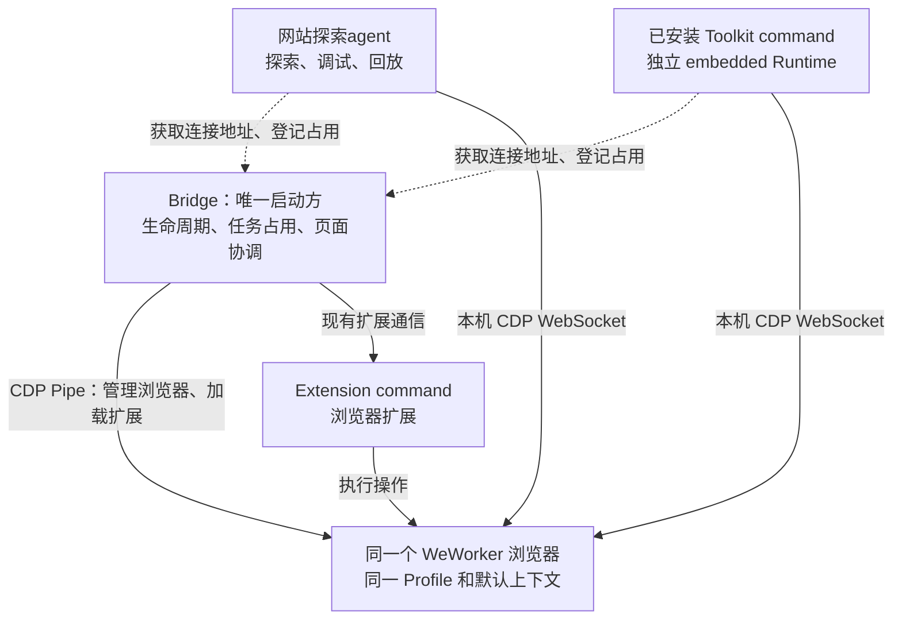

主人，最终方案采用：**Bridge 统一管理一个 WeWorker 浏览器；探索、调试、回放和已安装 Toolkit command 通过本机 CDP 直连；Extension command 保留现有扩展执行方式。**

本次统一浏览器资源和生命周期，两类 Adapter 仍保留各自的 Runner。

**实施范围和约定如下。**

1. **先验证双接口可行性，再更新设计约定。**

   使用独立临时 Profile，验证同一 Chrome／Edge 同时开启 `--remote-debugging-pipe` 和 `--remote-debugging-port=0`，能够完成扩展加载、Playwright 连接、双方操作及退出清理。使用当前项目锁定的 Playwright，不把升级依赖作为前提。

   通过后更新现有浏览器管理、嵌入式集成和 Toolkit 调用设计。尤其需要将现有「Toolkit 调用不启动 Bridge」改成「Toolkit 通过 Bridge 获取浏览器，业务仍由独立 Runtime 执行，不依赖探索服务」。

   这项验证是实施门槛；目标版本不兼容时，停在这里重新评估转接方案，不默默启动第二个浏览器。

2. **Bridge 成为唯一浏览器启动与恢复入口。**

   沿用当前专用浏览器管理器及其 Profile。保留 Pipe，增加仅监听本机的动态 CDP 端口。

   Bridge 只提供本次启动实例的连接信息，至少包含实例标识、CDP 地址和占用标识。端口发现由 Bridge 完成；Python 不读取浏览器 Profile、设置文件或其他 WeWorker 数据。

   并发启动请求共用一次启动过程。浏览器重启后产生新的实例标识，旧地址和旧页面绑定失效。不能把固定 `9222`、遗留端口文件或任意可连接的浏览器当作当前实例。

   浏览器状态区分「CDP 可用」和「扩展已连接」，Python 调用不必等待与它无关的扩展就绪条件。

3. **提供公共的浏览器控制客户端。**

   在 WebCLI 内收口浏览器获取、占用、释放和页面协调能力。复用现有 Node／WebSocket 依赖。

   Python 通过宿主已注入的 WebCLI 入口调用固定内部控制能力，使用 JSON 标准输入／输出交换控制信息；实际页面操作仍由 Playwright 直连 Chrome。内部连接与任务生命周期绑定，任务退出后释放占用。

   这样可以覆盖独立 CLI 和 Python Worker，同时避免新增 CDP 代理服务或一套 Python WebSocket 依赖。开发态和打包态使用同一控制合同。

4. **接通所有 Python 浏览器使用入口。**

   | 入口 | 必须完成的调整 |
   |---|---|
   | 浏览器状态、标签页列表、打开页面 | 从 Bridge 获取当前实例；只读查询不无故拉起浏览器 |
   | 探索与继续探索 | 执行前获取实例和占用，取消自行启动浏览器 |
   | 调试与回放 | 每次执行获取当前实例，不能依赖历史任务里保存的旧端口 |
   | 已安装 Toolkit command | CLI 直接调用和 Bridge 内部调用两条路径都接入 |
   | Toolkit 公共 Runtime | 使用宿主提供的实例信息，托管模式下取消连接失败后自行启动浏览器的兜底 |

   **Toolkit command 必须在探索服务完全关闭时仍然可用。** 独立 WebCLI 调用时按需启动 Bridge；缺少 embedded Runtime 时，继续返回明确错误。

   浏览器地址由宿主在运行时传入，不写进 Adapter 代码或安装包。使用公共 Runtime 的现有 Adapter 应通过宿主更新获得能力，不要求重新生成业务代码；对自带旧 Runtime 或自行启动浏览器的历史产物，先识别兼容性，不承诺直接覆盖。

5. **统一页面占用，保留 Toolkit 连续调用能力。**

   不同任务默认使用各自页面。同一 Toolkit 连续 command 保留已有页面复用和状态保存行为。

   页面锁统一关联浏览器实例、CDP `targetId` 和扩展 `tabId`，不通过 URL 猜测身份。锁必须覆盖探索、Toolkit、`browser.*`、WebCLI 探索以及普通 Extension 页面命令；扩展在选定实际页面后、开始导航或执行前登记占用。

   同页冲突明确返回忙碌状态，避免两边同时操作。使用同一 Toolkit Runtime Store 的并发调用，也需要保护页面选择和状态写入。

   后台 API 型 Adapter 保留后台执行方式，不因为这次统一而增加业务页依赖。共享 Cookie 等登录态，但不承诺不同标签页的 `sessionStorage` 自动共享。

   直连方案下，这些锁是各执行入口遵守的协作规则；它们不构成对任意 CDP 客户端的权限隔离。

6. **统一任务结束、故障恢复和窗口行为。**

   浏览器有活动任务占用时禁止空闲回收。成功、失败、取消、超时和 Worker 异常退出，都必须清理连接并释放占用。

   任务完成默认只释放自身资源；不关闭整个浏览器，不关闭用户已有页面。探索、登录或人工查看期间持有显示状态，自动隐藏不能把用户正在操作的窗口收走。

   浏览器或 Bridge 意外退出时，当前任务明确失败，已经执行的点击、提交和写命令不自动重放。后续新任务可以重新获取恢复后的浏览器。

   常规停止、重启和模式切换遇到活动任务时返回忙碌状态。应用退出按顺序结束相关任务，再清理自己拥有的 Bridge 和浏览器；外部 CLI 启动的 Bridge 继续遵守现有所有权边界。

7. **明确模式和既有数据的处理。**

   本轮统一保证覆盖默认「WeWorker 浏览器」模式。

   对「我自己的 Chrome」模式，建议保留现有 Extension 能力；需要 CDP 的探索和 Toolkit 调用明确提示切换到「WeWorker 浏览器」，不自动切换模式，也不另起浏览器。这项行为需写入产品约定。

   共用现有 WeWorker 浏览器 Profile。旧探索浏览器的数据保留原地，不自动合并或迁移 Cookie；只在旧探索浏览器登录过的网站，可能需要在共享浏览器重新登录。登录态共享从统一后的实例开始生效。

**改动主要集中在以下位置。**

| 模块 | 改动内容 |
|---|---|
| [浏览器管理器](/Users/xlinliu/projects/WeWorker/webcli/dedicated-browser.js) | 双接口启动、实例身份、动态地址、占用和生命周期 |
| [Bridge](/Users/xlinliu/projects/WeWorker/webcli/bridge.js) | 内部浏览器控制、页面协调、Toolkit 调用接入 |
| [Toolkit Runner](/Users/xlinliu/projects/WeWorker/webcli/toolkit-runner.js) 与 [CLI](/Users/xlinliu/projects/WeWorker/webcli/index.js) | 两条调用路径获取浏览器、环境传递、退出清理 |
| [探索运行环境](/Users/xlinliu/projects/WeWorker/components/webwright/src/webwright/environments/local_browser.py) 与 [公共 Toolkit Runtime](/Users/xlinliu/projects/WeWorker/components/webwright/src/webwright/tool_runtime/toolkit_runtime.py) | 统一获取实例、禁用托管入口自行启动、页面和连接管理 |
| [探索进程管理](/Users/xlinliu/projects/WeWorker/components/webwright/src/webwright/server/process_manager.py) | 探索、调试、回放的动态实例获取和取消清理 |
| [扩展执行入口](/Users/xlinliu/projects/WeWorker/extension/background/service-worker.js) | 普通页面命令接入跨调用方页面占用 |
| Electron 和相关界面 | 退出顺序、自动隐藏协调、模式及失败提示 |

实施顺序为：**隔离验证 → 更新规范 → Bridge 管理能力 → Toolkit 普通调用闭环 → 探索／调试／回放 → 并发与生命周期 → 打包验收。** 优先完成 Toolkit 普通调用，确保最容易遗漏的独立执行链先跑通。

**最终验收以实际行为为准。**

| 场景 | 通过标准 |
|---|---|
| 首次从探索启动，随后执行两类 Adapter | 共用同一受管实例和 Profile |
| 首次从 Toolkit command 启动 | 自动取得共享浏览器，不需要探索服务 |
| 桌面端关闭，使用包含 Runtime 的独立 WebCLI | Toolkit command 可执行，结束后按空闲策略回收 |
| 多个入口同时首次调用 | 仅启动一次受管浏览器 |
| 探索与 command 同时执行 | 不同页面可并行，同页冲突明确失败 |
| 同一 Toolkit 连续调用 | 正确复用页面和状态；并发不覆盖状态 |
| 浏览器重启或旧任务恢复 | 获取新实例，旧端口和旧页面不能误用 |
| 提交后断线、取消或超时 | 不自动重复提交，结果明确标记失败或不确定 |
| 长任务、人工登录、自动隐藏 | 不被空闲回收，不打断人工操作 |
| 后台 API 型 Adapter | 仍可在无需业务页的条件下普通调用 |
| Bridge／Runtime 异常退出及应用退出 | 无任务进程泄漏，不清理未知进程 |
| 开发态与打包态 | CLI、Bridge、扩展和 embedded Runtime 行为一致 |

“一个实例”按受管浏览器主实例和 Profile 判断，Chrome 正常的 Renderer／GPU 子进程不算额外实例。

验证包含相关 Node、Python、扩展和 Electron 聚焦测试，Renderer 受影响部分的测试与构建，以及最终 CLI／Bridge／embedded 打包后的真实闭环。macOS arm64、macOS x64、Windows x64 分别记录结果；没有实机验证的平台保留为待验收。实施进度同步到两级 `ROADMAP.md`，只有实现并验证通过的事项标为完成。

本轮只生成方案，尚未修改文件或开始实施。