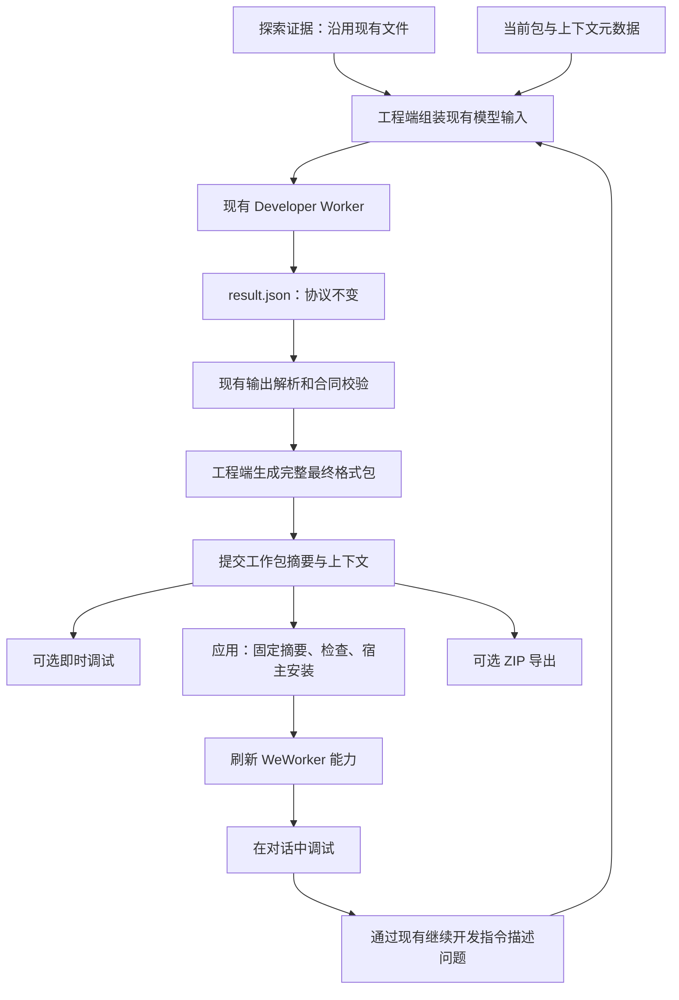

# 网站探索agent：开发产物与直接应用 Adapter 实施方案

日期：2026-11-01  
状态：代码已实施，聚焦自动化回归已通过；真实桌面对话验收尚未执行。  
适用范围：WeWorker 托管的网站探索agent、Renderer 开发工作区和 Backend 安装编排。

## 1. 需求与目标

### 1.1 已确认需求

1. 取消独立的「Adapter 验证」步骤。开发完成后，点击「应用到 Adapter」，即可生成并应用到 WeWorker。
2. 主要功能调试转移到 WeWorker 的真实对话中。发现问题后回到开发区继续修改，再次应用。
3. 简化开发结果到安装包的文件流转，减少同一业务代码以不同中间形态重复保存。
4. 模型交互边界、通信协议、提示词保持不变。模型继续生成业务函数和现有结构化字段，不承担完整包管理工作。
5. manifest、固定运行入口、固定资源和安装过程继续由工程端维护；不能用增加模型职责换取工程简化。
6. 保留草稿和已安装版本的隔离。开发失败或应用失败，不能破坏上次成功安装的版本。
7. 用户会自行删除旧数据。新方案从空工作区开始，不实现旧数据读取、迁移、转换、恢复或新旧版本并行兼容。

### 1.2 本方案采用的工程决策

以下是为满足需求而确定的设计，不把它们误认为用户额外提出的功能：

- 即时调试保留为开发辅助工具，但成功记录不再作为应用或导出的前置条件。
- 从模型成功输出开始，工程端立即生成最终包格式；应用阶段不再转换业务代码。
- 使用一套最终包格式和少量状态元数据。允许工作版本、基线版本、安装暂存具有不同副本，它们不是不同代码格式。
- 「应用到 Adapter」按整个 Adapter 的已保存工作版本生效。界面明确列出本次涉及的命令，不能只显示当前 Tool 而暗中应用其他 Tool。
- 首期不增加对话日志自动回传开发 Agent 的新协议。用户可以通过现有继续开发指令描述问题，调试证据入口沿用现有模型合同。
- 导出复用当前已保存工作版本，不受业务验证记录限制；导出不等于已安装，也不标记为功能验证通过。

### 1.3 不在本次范围内

- 更改探索策略、模型 Provider、请求参数、模型输出格式或修复轮次。
- 让模型直接编辑 manifest、运行入口或任意资源文件。
- 改变 Extension、Toolkit、HTTP 的执行协议，或合并它们的 Runner。
- 新增自动业务测试、自动执行写操作、自动把对话记录发送给开发模型。
- 修改数据库 schema、依赖、CI/CD、发布流程、密钥或环境文件。
- 旧数据兼容、迁移工具、旧客户端适配和过渡期双写。
- 用户自行负责旧数据删除，本次工程实现不承担清理；自动卸载 Adapter 或执行 Git 回滚也不在范围内。

## 2. 当前实现与问题

本节依据当前源码核对，区分现有事实和后续设计。

### 2.1 当前主流程

```text
探索证据
  → input.json / development_spec.json
  → Developer Worker 调用模型
  → result.json：{ ok: true, slot: ... }
  → development/<tool-id>/current.json：开发代码和定义
  → 开发即时调试成功
  → 点击「应用到 Adapter」
  → tools/<tool-id>/formal.json：正式代码和定义
  → 生成 v2 包快照，并更新当前快照指针
  → 独立 Adapter 验证成功
  → 点击「应用到 WeWorker」
  → 宿主安装、能力刷新
```

关键实现位置以各模块源码根为基准：

| 模块 | 文件与当前职责 |
|---|---|
| Python 开发 Worker | `run/tool_development.py`：提示词、结构化输出协议、一次输出修复、写入结果 |
| Python 开发上下文 | `server/development.py`：组装 `base_slot`、探索和调试证据 |
| Python 进程管理 | `server/process_manager.py`：进程通信文件、接收结果、写开发槽位 |
| Python 存储 | `server/toolkit_store.py`：开发槽位、正式槽位、代码摘要和并发保护 |
| Python 包生成 | `server/adapter_v2.py`：将正式槽位包装成命令文件、manifest 和内容快照 |
| Python 应用与导出 | `server/publisher.py`、`server/app.py`：发布资格、正式验证资格、包与导出接口 |
| Renderer | `DevelopWorkspace.jsx`、`WebsiteExplorationPage.jsx`：开发应用与独立验证页 |
| Backend | `website-exploration-adapters.ts`：宿主包检查、安装评审、安装与刷新回调 |
| 公共安装模块 | `webcli/adapter-install-store.js`：包固定、安装事务、状态提交和恢复 |

### 2.2 需要解决的问题

- 「应用到 Adapter」当前只更新探索工作区产物，不代表宿主已经安装。
- 开发调试与正式验证两次运行门槛使开发、安装、真实对话调试脱节。
- 同一业务实现保存在开发槽位、正式槽位和最终命令文件中，应用时还需要重新包装代码。
- 模型输出里的代码与用户最终运行的完整命令文件之间缺少直观对应。
- 安装、刷新和探索端状态确认跨进程，不能用一次前端成功提示覆盖中间失败。

## 3. 模型侧冻结合同

### 3.1 必须保持的内容

| 边界 | 冻结要求 |
|---|---|
| 提示词 | system prompt、示例、输出修复提示原样保留 |
| 输入 | `toolkit`、`tool`、`base_slot`、`source_exploration`、`debug_run_evidence`、`instruction` 的结构和选择规则保持一致 |
| 输出 | 仍只有 `code`、`description`、`parameters_schema`、`result_schema`、`risk_notice` 五个字段 |
| Schema 编码 | 模型线上输出的两项 Schema 仍为 JSON 对象字符串；现有解析器解码后才进入工程端 |
| 函数合同 | 保持现有函数命名、`ctx` 参数、参数与 Schema 对应和代码校验规则 |
| 模型调用 | 保持请求构造、响应提取、重试、一次输出修复以及错误分类 |
| Worker 通信 | 保留 `input.json`、`development_spec.json`、`result.json` 和现有结果结构 |
| 证据处理 | 保持现有脱敏规则；不将运行入口、包管理状态或额外业务数据加入模型上下文 |

不借此重构修改既有提示词中对执行方式的描述。已有后台 API 能力必须保留；如果某种能力在当前模型合同内无法正确处理，应明确返回限制，不通过扩大模型合同或改成页面调用绕过。

### 3.2 存储变化不能泄漏到模型输入

工程端从最终包和元数据组装模型所需的原有字典结构，不读取旧代码槽位 JSON。内部读取函数可以重构或改名，不必为旧存储保留接口；必须保持的是模型实际收到的输入合同。

- `base_slot` 中的 `code` 是模型原始业务代码，不包含运行包装。
- 代码空白、注释、尾部换行均须可无损还原；不能用 AST 反编译或代码格式化来重建输入。
- `description`、两项 Schema、`risk_notice` 和来源字段按现有语义还原。
- `tool` 中会传给模型的槽位存在标志，以及 `source_exploration_id`、`based_on_formal_hash`、`debug_run_evidence_id`、`updated_at` 等上下文信息继续维持原有语义。
- 生成包、刷新界面、安装重试不能顺带修改业务代码时间戳或上下文来源。
- 安装成功后可以在逻辑上结束本轮开发，但工作包文件继续保留；再次开发时通过模型输入组装层提供原有结构的已应用代码上下文。

改造前后的模型输入等价检查使用合成夹具、相同逻辑状态和固定时间，不读取用户旧数据，也不要求不同安装时刻的请求字节相同；相同输入条件下，请求内容、字段类型与序列化顺序必须一致。

## 4. 文件格式与持久化设计

### 4.1 文件分层

| 层 | 文件格式 | 是否修改 | 是否可作为业务代码事实来源 |
|---|---|---|---|
| 探索证据 | 现有 JSON、JSONL、步骤 `.py`、截图等 | 不变 | 仅作为探索证据 |
| Worker 通信与任务记录 | `input.json`、`development_spec.json`、`result.json`、日志 | 协议不变 | 否；可保留任务输入输出用于排错 |
| Adapter 包 | `manifest.json`、现有命令 `.py`、原有资源 | 提前生成 | 是；当前代码从选定包读取 |
| 工作区状态 | 小型 JSON | 新增格式版本与包引用 | 记录状态、来源及无法从包还原的字段，不保存完整代码 |
| 应用操作记录 | 小型 JSON | 增加恢复与幂等状态 | 不保存第二套代码 |
| 宿主安装包 | 与 Adapter 工作包相同 | 复用安装模块 | 宿主实际运行版本的依据 |
| 可选导出 | ZIP | 直接打包选定工作包 | 仅为传输封装 |

这里减少的是长期参与编辑和构建的代码形态。Worker 的历史结果仍可能含代码，因为它属于已冻结的通信协议；不宣称所有代码副本都会消失。

### 4.2 物理存储建议

持久根保持仓库规范指定的位置。用户清理旧数据后，直接创建以下新 Toolkit 工作区；程序不扫描旧格式，也不读取、迁移或清理旧的独立产品数据目录：

```text
<toolkit-workspace>/
  .server/
    toolkit.json                    # 沿用现有 Toolkit 元数据
    workspace.json                  # 当前包、基线包、已应用包引用和 Tool 上下文
    apply-operations/<id>.json       # 应用事务记录，不含包内容
    development_runs/<run-id>/       # 现有 Worker 通信和日志，保持协议
  tools/<tool-id>/tool.json          # 功能目标、起始网址等既有定义
  packages/<package-digest>/<adapter-name>/
    manifest.json
    <现有 Adapter 规定的命令目录>/
    <原有资源文件>
```

工作副本是 `workspace.json` 指向的完整最终包，界面不要求用户认识摘要路径。包对象写入后不可变，编辑通过生成新包并原子切换指针实现。

选择不可变包对象的理由：manifest 和命令代码必须作为同一版被读取，不能在多文件写到一半时被安装。包对象按内容摘要复用；相同内容不再产生第二份同样的包。

工作区只需识别当前工作包、最后应用包、原始导入基线，以及未结束应用引用的包。这些都是新流程运行后产生的数据；必要的版本隔离与事务恢复不因取消旧数据兼容而移除。新流程产生的未引用包如何回收不属于本次改造范围。即使暂时保留多个摘要目录，它们仍是一种最终包格式，不恢复开发/正式两套代码 JSON。

Python 只写自己的工作区；宿主安装目录仍由 Backend 和公共安装模块写入。Python 不通过文件路径读取宿主设置、数据库、浏览器 Profile 或用户安装目录。

### 4.3 工作区状态字段

建议包含以下逻辑字段；实际名称在实现时统一，但语义不得省略：

| 字段 | 用途 |
|---|---|
| `storage_version`、`revision` | 格式识别、乐观并发控制 |
| `adapter_name`、`profile` | 身份和构建 profile 绑定 |
| `candidate_digest` | 当前完整工作包 |
| `retained_base_digest` | 初始导入包，保护原有命令和资源 |
| `last_applied_digest`、`host_revision` | 最近一次宿主已确认安装的版本 |
| `development_contexts` | 正在开发的 Tool、来源、代码摘要、函数代码区间及现有上下文字段 |
| `applied_contexts` | 最近已应用 Tool 的上下文字段；代码通过包摘要引用 |
| `install_baseline_digest` | 本轮安装预期覆盖的宿主版本，首次安装为显式空值 |

初始导入基线与最近安装基线必须分开：前者用来保护原有命令，后者用来检测其他入口安装了新版本。不能每次安装后把所有自产命令都变成不可修改的保留命令。

两项上下文只保存维持模型合同所需的元数据，不复制整份 manifest、完整代码或 Base64 包。包中已有字段通过读取恢复；`risk_notice`、原始说明和原始结果定义等不能无损推导的值保存在上下文中。允许有必要的定义元数据冗余，但不能形成可独立编辑的第二份代码源。

### 4.4 业务代码的无损读取

沿用现有运行包装器及运行协议，由包生成器明确拼接「固定前缀 + 原始业务代码 + 固定后缀」。

1. 不修改 `slot.code` 的内容，不使用 `rstrip()` 后的结果代替原文存储。
2. 在包外上下文中记录命令路径、UTF-8 字节区间、原始代码摘要、模板版本。
3. 读取时先校验包摘要、路径、区间和代码摘要，再取回原始字节并按 UTF-8 解码。
4. 区间无效或包被外部修改时明确报错，不通过模糊字符串匹配或执行模块来提取代码。
5. 包生成后运行语法和现有合同检查；这种检查不执行业务命令。

模板变更仅限支持无损存储所需的确定性包装调整，不改变运行参数归一化、鉴权、浏览器依赖或结果输出。测试证明与既有生成器的执行语义等价。

## 5. 全流程转换



### 5.1 开发结果落盘

1. Worker 按原合同返回结果，进程管理器保留现有成功、失败、取消、超时处理。
2. 工程端读取当前工作区 revision，校验模型结果和目标 Tool 身份。
3. 以当前包为基础，只更新本次开发命令及程序允许更新的 manifest 字段；保留其他已保存命令和资源。
4. 固定模板生成命令入口，构建完整包，完成语法、路径、引用和包结构检查。
5. 先写临时目录，再固定到摘要目录；读回核对内容摘要。
6. 在锁内比较预期 revision，原子提交工作区状态，使代码与上下文同时指向同一版。
7. 生成或提交失败时保留旧指针，任务返回明确工程错误，不追加新的模型修复请求。

手工编辑继续通过现有业务代码编辑入口完成，也必须走相同的包生成与 revision 检查路径。首期不引入任意文件编辑器。

### 5.2 版本和确定性

- 新 Adapter 的初始版本和已有包版本处理沿用现有规则，由程序维护，模型不参与。
- 在一次工作版本周期内确定目标版本；重复保存、重试、导出和安装不再反复递增版本号。
- 成功应用后，下一次产生实质修改才创建下一目标版本；版本字段也在工作包生成时落定。
- 同一基线、同一目标版本、同一模型结果和同一模板应生成相同包摘要。
- 包中不加入开发时间戳、机器路径、任务日志或安装状态，避免无意义摘要变化。
- 预发布版本等边界交由现有版本解析规则处理；不在本轮另造宽松版本解析器。

### 5.3 应用与范围

应用对象是整个 Adapter 当前已保存包。未开始开发的 Tool 不加入 manifest；其他已保存但未应用的命令一并显示在应用范围中。未保存编辑、正在写入的开发任务或结构检查失败会阻止应用。

固定摘要后不再重新生成代码。一次应用采用该摘要下的文件，即使之后开始新开发，也不能偷偷换成新内容。应用旧快照成功后若已有更新 revision，只更新已应用引用，不能清空或覆盖新工作版本。

### 5.4 安装编排和失败恢复

由 Backend 编排宿主安装，Renderer 负责发起和展示，Python 提供包及工作区状态。保留现有宿主安装事务作为唯一安装写入入口。

```text
准备：固定工作区 revision、包摘要、宿主基线、应用范围
  → 沿用安装评审：权限、来源、降级、并发版本变化
  → 提交：重新核对评审和摘要，调用现有 installAdapter
  → 宿主状态提交成功
  → 清缓存、同步能力、发送现有状态事件
  → 将安装结果确认给探索工作区
```

每次操作使用幂等 operation id，关联包摘要、工作区 revision、宿主基线及 profile。复用相同 operation id 重试时，先查询宿主权威状态；已经安装同一包则补做刷新或确认，不能重新提升版本或重复生成。

| 情况 | 处理 |
|---|---|
| 包生成或检查失败 | 保留上次有效工作包；标记开发结果未成功保存 |
| 安装评审需要确认 | 展示具体变化；取消后保留工作包，不修改已安装版本 |
| 宿主版本与预期不符 | 返回冲突并重新评审；不静默覆盖 |
| 安装提交前失败 | 保留原安装版本和当前草稿，允许同摘要重试 |
| 安装成功、响应丢失 | 通过宿主摘要与 operation 状态查明结果，不直接重装 |
| 安装成功、能力刷新失败 | 显示「已安装，能力同步待完成」，重试刷新 |
| 安装成功、探索端确认失败 | 显示状态同步待完成；恢复后按宿主事实补确认 |
| 应用期间产生新草稿 | 安装固定的旧快照，新草稿继续显示未应用 |
| 进程重启 | 根据操作记录和宿主摘要恢复；不自动执行任何业务调用 |

仅当安装和本方案约定的能力同步检查完成后，显示「已应用，可在 WeWorker 对话中调试」。安装检查成功不表示业务功能验证通过。

### 5.5 能力刷新和真实调用

现有刷新回调清缓存、同步 Skill 并发送状态事件，可作为入口，但事件发送成功不等于所有消费者已加载新版本。实施时必须核对 Renderer、Bridge 和执行器实际使用摘要或 revision 的时机。

- 目标是应用完成后的新调用解析到新版本；如果尚未同步，保持待同步状态。
- 已执行中的调用保持它已经取得的版本，不中途替换文件。
- 已有对话可能保留旧的工具说明；需验证现有上下文刷新能力。若不能可靠刷新，明确引导新建对话，不承诺旧对话自动获得新 Schema。
- 从真实对话走正常 `webcli call <adapter-id>.<tool-id>` 链路，不新增专用调试 Runner。
- Toolkit 普通调用继续不依赖探索服务；共享浏览器仍由 Bridge 唯一管理。

## 6. 接口和界面改造

### 6.1 服务接口

本次冻结的是模型与 Worker 协议；工程端 HTTP 接口可以调整，但需由客户端和服务端共同完成。

| 接口领域 | 改造内容 |
|---|---|
| 开发读取/保存 | 外部维持现有业务代码结构；内部改从包和上下文读写 |
| 包状态 | 返回候选摘要、工作区 revision、结构检查、变更命令及应用状态，不从 Debug Run 推导可应用性 |
| `v2-package` | 返回已固定摘要的最终包；去除成功正式 Debug Run 门槛，保留实例、包和基线校验 |
| `install-review` | 绑定候选摘要、revision、宿主基线和安装变化 |
| `install-apply` | 复用现有安装逻辑，补充操作标识、状态恢复和探索端确认 |
| 操作查询/重试 | 可查询安装、刷新、确认三个阶段，支持幂等恢复 |
| `export-status` / `export` | 资格来自包完整性；导出固定当前摘要，不执行模型或业务工具 |
| 原 `publish` | 直接替换本地正式化流程，前后端同步接入新的宿主应用编排；不保留旧客户端兼容期或旧语义分支 |
| 原调试接口 | 保留可选开发调试与历史记录读取；正式通道退出用户主流程 |

新增工程接口必须同步 Backend 代理白名单、资源路径映射、服务描述和聚焦测试，不能开放任意上游路径或任意文件访问。

### 6.2 Renderer

1. 主工作区保留「探索」「开发」，移除「Adapter 验证」标签和独立安装入口。
2. 移除 `verify` 页面状态和导航入口；活动中的调试任务定位到开发页，不实现旧页面状态迁移。
3. 开发页「应用到 Adapter」执行完整安装流程，显示整个 Adapter 的本次变更命令。
4. 按钮资格由服务端工作包状态决定，不依赖 `publish_eligible` 的调试成功记录。
5. 即时调试标注为可选，移除「先测试才能应用」文案；保留现有失败证据用于继续开发。
6. 安装变化确认复用现有组件，保留新增权限、来源变化、版本变化等实际需要确认的情况，不新增无意义确认步骤。
7. 导出入口移到 Adapter 操作区，避免与安装成功混淆。
8. 应用成功后刷新 Adapter 目录及能力展示；提供明确的对话调试提示。
9. 保留未保存代码的离开保护、任务运行时操作限制、错误提示和主题样式。

## 7. 新工作区初始化与已有 Adapter 扩展

### 7.1 扩展当前已安装包

用户清理旧探索数据不影响产品继续支持扩展内置或新安装的 Adapter。以下约束适用于新流程主动从宿主导入当前包，不属于旧工作区数据迁移。

- 复用宿主受验证的包读取和导入能力，保持原来的 runtime、execution、鉴权来源与页面依赖。
- 原有 Extension/HTTP 命令、资源和 manifest 非本次修改字段保持不变。
- 继续执行 `retainedFilesUnchanged` 等现有保护，不以“重建完整包”为理由放宽修改范围。
- 只对当前工作区拥有的新增 Toolkit 命令继续开发，不擅自开放任意既有命令修改能力。
- 对同名命令冲突、外部包被更新、profile 改变返回明确冲突。
- 普通 WebCLI 不增加按业务 Schema 转换参数的逻辑；现有命令包装器处理规则保持等价。

### 7.2 从空工作区初始化

1. 旧数据由用户自行删除；部署和验收以空探索工作区为前提。
2. 新建 Toolkit 时直接创建新格式元数据，首次开发成功后创建工作包；不检测、读取或转换旧槽位及旧包快照。
3. 新建 Adapter 的安装基线为空；主动扩展当前已安装 Adapter 时，基线来自宿主提供的受验证包。
4. 仅实现新格式读写，不增加旧格式分支、迁移脚本、双写或新旧客户端共存机制。
5. 保留新流程自身的原子写入、版本隔离、失败重试和进程重启恢复。这些机制保护新产生的数据，不处理旧数据。
6. 模型合同回归使用合成测试夹具，证明改造前后交互保持一致，不依赖用户历史数据。

本方案不修改数据库 schema。后续如实现确实需要调整数据库、删除文件或发布配置，必须遵守仓库要求另行确认，不能把本方案视为这些动作的授权。

## 8. 实施阶段与交付物

| 阶段 | 工作 | 完成条件 |
|---|---|---|
| P0：冻结基线 | 固定模型输入输出、修复请求、包生成和普通调用夹具；明确所有写槽位入口 | 现有聚焦测试通过，模型合同快照可比较 |
| P1：包存储与模型输入组装 | 实现新工作区初始化、内容包对象、工作区状态、无损代码提取、锁与 revision | 不改 Worker，模型输入与基线等价；异常中断不出现混合版本 |
| P2：提前生成 | 在开发成功和手工保存时生成最终包；重启/重新开始/取消入口统一适配 | 后续输入与原协议一致；新路径不写代码槽位 JSON |
| P3：宿主直接应用 | 去除运行成功门槛；接通评审、安装、刷新、确认、操作恢复；导出同包 | 无业务 Debug Run 也可应用，失败与重试行为明确 |
| P4：界面收敛 | 移除验证工作区，合并应用入口，显示作用范围和阶段状态 | 用户可从空工作区完成探索→开发→应用→对话调试 |
| P5：回归与文档 | 混合包、版本冲突、实际调用和打包验证；更新旧设计中相冲突内容 | 验收矩阵通过，剩余限制明确记录 |

P1–P4 可以分批提交代码，但前后端按同一版本整体启用，完整链路通过后从空工作区验收。不设置新旧数据兼容开关，不实现过渡期双写。

本轮只更新方案文档。用户自行清理运行数据；实施时按新流程替换调用链，如需物理删除源码文件，遵守仓库单独确认要求。

## 9. 验证与验收

### 9.1 必须覆盖的自动化测试

| 场景 | 通过标准 |
|---|---|
| 模型协议冻结 | 提示词、请求结构、修复请求、输出字段和 Worker 结果文件与基线一致 |
| 上下文等价 | 初次开发、继续开发、从已应用版本开发、从探索重开、关联调试证据均产生等价模型输入 |
| 原样取回代码 | 中文、注释、空行、尾部换行、类似边界的字符串均可无损恢复 |
| 生成器等价 | 函数、参数归一化、Schema、运行入口、结果输出保持既有语义 |
| 文件事实来源 | 新工作区不再生成含代码的开发/正式槽位 JSON；协议日志保留不计为失败 |
| 完整包提交 | manifest 或代码写入中断，读者仍只见上一完整版本 |
| 同一输入确定性 | 重复生成内容摘要一致；安装重试不改变目标版本 |
| 无验证门槛 | 无 Debug Run 或调试失败仍可应用结构有效的包，不自动执行业务工具 |
| 范围清晰 | 多命令已保存修改按展示范围一起应用；未保存或正在写入时不能误用半成品 |
| 并发修改 | 手工编辑与 Agent、应用与继续开发发生竞争时拒绝过期写入或保留新版本 |
| 安装恢复 | 提交前失败、响应丢失、刷新失败、确认失败均可幂等恢复 |
| 权限与版本 | 原权限评审、来源确认、降级检查、宿主 revision 和 profile 隔离继续生效 |
| 混合 Adapter | 既有 Extension/HTTP 文件与命令不变，新增 Toolkit 命令可普通调用 |
| 导出一致性 | ZIP 内包文件与选定工作包逐字节一致，不含开发日志或用户数据 |
| 全新工作区 | 空目录初始化、首次开发与首次安装成功；新流程只写新格式 |
| 前端状态 | 未保存离开保护、应用范围、安装待同步、重试和新流程导航都有聚焦覆盖 |

测试全部使用公开占位域名与虚构数据，禁止使用真实账号、Cookie、私有业务记录和用户目录。模型合同回归以桩模型完成，不依赖线上模型随机结果。

### 9.2 执行入口

具体新增测试文件按实现拆分，至少运行以下既有入口及新增对应测试：

- 在网站探索agent 源码目录使用 `uv run python -m pytest tests/unit/test_toolkit_store.py tests/unit/test_development_publish.py tests/unit/test_debug_run.py`；补充包存储和协议等价测试。
- 在 Backend 目录运行 `npm run test -- src/__tests__/website-exploration-adapters.test.ts src/__tests__/website-exploration.test.ts src/__tests__/website-exploration-identity.test.ts`，并运行 `npm run typecheck`。
- 在 Renderer 目录运行 `node --test src/__tests__/website-exploration.test.js` 及新增应用流程测试；对改动的普通 JS 运行 `node --check`，JSX 由构建解析检查；执行 `npm run build`。
- 复用宿主安装、状态刷新和运行时重载测试；确有改动才扩展公共 WebCLI/Extension 测试范围。
- 若触及嵌入式分发或构建入口，先读取该目录规范，再验证开发态和打包态入口一致；不为本重构调整打包范围或依赖。

### 9.3 人工端到端验收

1. 在公开测试页面完成探索和开发，未运行即时调试即直接应用。
2. WeWorker 对话通过正常调用链使用新命令，参数和返回结果正确。
3. 继续开发后再次应用，下一次新调用使用新版本；已有调用不读取被替换到一半的文件。
4. 验证旧对话的能力刷新；不支持时，新建对话提示明确且新对话可用。
5. 停止探索服务后，已安装 Toolkit 命令仍可正常调用。
6. 对原本支持后台 API 的命令验证真实后台运行方式；只关闭本次验收创建的业务页，不关闭用户已有页面。
7. 模拟宿主安装失败和刷新失败，确认旧版本或明确的待同步状态仍可恢复，草稿不丢失。
8. 使用已有混合 Adapter 新增命令，原有命令、鉴权和资源保持可用。

## 10. 风险、完成标准与文档关系

### 10.1 主要风险与对策

| 风险 | 对策 |
|---|---|
| 存储改造间接改变模型上下文 | 先冻结协议和输入快照；从新包与元数据组装原有模型输入结构 |
| 提取业务函数损失空白或注释 | 保存字节区间和摘要，禁止格式化重建 |
| 去掉运行门槛后把损坏包装入宿主 | 保留完整的结构、语法、路径和宿主包检查；业务效果由真实对话调试 |
| 应用跨两个进程误报成功 | 宿主状态为安装事实来源；区分安装、刷新、确认并支持幂等恢复 |
| 多命令草稿被意外一并安装 | 明确 Adapter 级应用范围，提交固定快照，展示所有变更命令 |
| 误改既有后台能力 | 保留已有包、严格限制修改范围，验收真实运行方式 |
| 为减少文件而损害故障恢复 | 保留同格式快照和小型事务状态，不把文件数量当成唯一指标 |

### 10.2 完成标准

- 用户不再进入 Adapter 验证页，也不需要先跑业务测试才能应用。
- 一次应用操作完成宿主安装和明确的同步反馈，失败后可恢复且不丢失新草稿。
- 模型交互合同和模型职责保持不变，未新增模型请求或修复轮次。
- 工程端在开发保存时就生成最终格式包，安装与导出不再次转换业务代码。
- 开发/正式代码 JSON 不再是新工作区的持久代码源；协议文件、证据和必要恢复元数据保留。
- 从空工作区完成全部流程，不包含旧数据读取、迁移、转换或双写实现。
- 既有 Adapter 的执行方式、权限保护和宿主模块边界保持有效。
- 方案中的自动化与端到端验收完成，未通过项不能以“已安装”代替验证结论。

### 10.3 与既有文档的关系

本方案记录本次重构的目标设计与实施结果。独立验证入口和本地发布 HTTP 入口已移除；既有开发与验证重设计文档、产品设计、技术设计已标注现行合同和历史章节边界。共享浏览器设计和 Adapter v2 安装协议继续作为约束，不被本方案替代。


## 11. 本次代码实施记录（2026-11-01）

### 11.1 已接通的流程

- 开发完成、手工保存以及起始地址、域名等工程元数据修改，均由工程端生成最终格式候选包。
- 新工作区不写开发/正式代码 JSON；读取模型所需的 slot 时，从命令文件的 UTF-8 字节区间和上下文元数据恢复原有字典。模型提示词、输出校验、输入组装和子进程通信实现未修改。
- 开发页直接请求宿主安装评审和安装；独立验证页已移除，即时调试仍可选。新增权限、来源、降级、覆盖更新及多个命令的变更范围会在应用前显示确认。
- 宿主先验证固定候选包并安装，再刷新能力、确认工作区状态。已经安装相同摘要时仍重试刷新与确认，不重复安装；界面区分安装成功、能力同步待完成和开发区同步待完成。
- 原始导入包与后续安装基线分开记录。既有 Extension/HTTP 命令、资源和元数据仍受宿主保留内容检查保护。
- 包目录包含 Adapter 名称以复用现有隔离运行器；Windows 使用扩展路径支持较长摘要与命令文件名。没有新增运行依赖，也没有改动 WebCLI、Extension 或共享浏览器协议。

### 11.2 状态与恢复细节

`workspace.json` 保存候选与已应用摘要、原始包引用、每个命令的上下文和草稿修订号。安装操作由包摘要与工作区修订号定位，记录确认所对应的上下文；宿主确认携带操作 ID、摘要、profile 和安装 revision。

安装期间继续保存的代码或元数据不会被确认操作清除；新候选包以最新已安装版本继续递增版本号。生成失败时不切换包引用。进程重启后，宿主实际安装摘要仍是事实来源。若宿主已安装而确认响应丢失，下次评审会先用新流程的操作记录对账，再推进新草稿版本；用户重试应用即可完成未完成的刷新或确认。没有为旧数据加入兼容入口，也没有执行用户数据删除。

### 11.3 验证范围与待验收项

自动化覆盖原始代码字节往返、模型输入等价、生成失败原子性、多命令应用、连续版本递增、混合包保留、ZIP 字节一致、元数据并发保存、安装确认重试、过期评审拒绝、前端权限与多命令确认、开发区离开保护，以及现有运行器路径。

真实桌面中从探索开始，经模型开发、点击应用、进入对话调用的人工闭环尚未执行；真实网站后台 API 与任务自有页面关闭后的验收也未执行。可选真实 CDP 验收脚本已更新为 v2 包与宿主 WebCLI 调用，需由明确配置的测试环境显式启用，不接管未知浏览器或占用端口。


### 11.4 自动化验证结果

- Python 聚焦回归：127 项通过，1 项真实 CDP 验收按显式开关跳过。
- Backend：3 个相关测试文件、40 项测试通过；TypeScript 类型检查通过。
- Renderer：9 项测试通过；改动普通 JS 的语法检查与生产构建通过。
- Git 差异空白检查通过；模型提示词、模型输入组装及 Worker 启动/通信源文件无改动。
- 构建仍提示现有动态导入与包体积告警，未阻止构建。

测试使用临时工作区和桩模型/宿主环境，没有操作用户的旧数据、真实网站会话或在用浏览器。真实 CDP 测试未运行，不能将上述结果视为真实桌面对话验收已完成。
